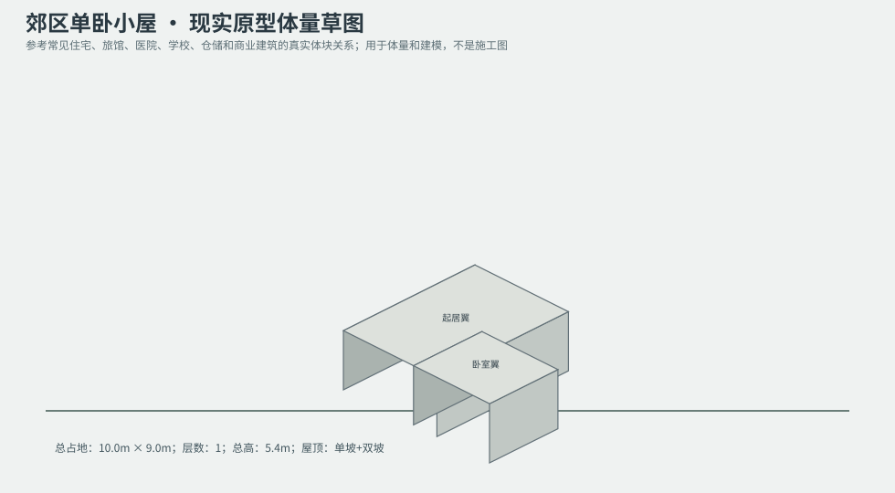
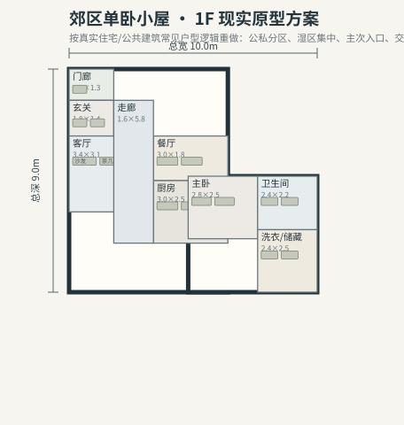

# BLD_001 · 郊区单卧小屋 — 现实原型重制说明

## 重制目标
本建筑按真实世界常见建筑原型重做，强调：体量变化、主次入口、公私分区、湿区集中、楼梯/电梯核、后勤空间、车库或设备翼、以及更合理的家具和动线。

## 基本参数
- 使用性质：居住
- 占地：10.0m × 9.0m
- 层数：1
- 总高：5.4m
- 屋顶：单坡+双坡
- 外立面：木框架/浅灰挂板

## 分层布局

### 1F

| 空间 | 尺寸（米） | 家具/设施 | 现实依据与功能 |
|---|---|---|---|
| 门廊 | 1.8 × 1.3 | 长椅 | 按真实房型功能组织 |
| 玄关 | 1.8 × 1.4 | 鞋柜、换鞋凳 | 按真实房型功能组织 |
| 客厅 | 3.4 × 3.1 | 沙发、茶几、电视柜 | 按真实房型功能组织 |
| 餐厅 | 3.0 × 1.8 | 餐桌、餐椅 | 按真实房型功能组织 |
| 厨房 | 3.0 × 2.5 | 台面、冰箱、水槽 | 湿区集中 |
| 走廊 | 1.6 × 5.8 | 无 | 交通空间 |
| 主卧 | 2.8 × 2.5 | 双人床、衣柜、床头柜 | 按真实房型功能组织 |
| 卫生间 | 2.4 × 2.2 | 马桶、洗手盆、淋浴间 | 湿区集中 |
| 洗衣/储藏 | 2.4 × 2.5 | 洗衣机、烘干机 | 湿区集中 |

## 游戏实现建议
- 用门、窗、楼梯、电梯核和家具碰撞去驱动导航，而不是只看外轮廓。
- 体量图中的不同翼楼、附属房和门廊建议建成独立美术模块，便于LOD和损坏替换。
- 房间容器建议按用途绑定掉落池，如厨房、药房、后仓、设备间、宿舍、档案室等。
- 真实导向不等于过度复杂；仍需为AI寻路、玩家识别和性能服务。
