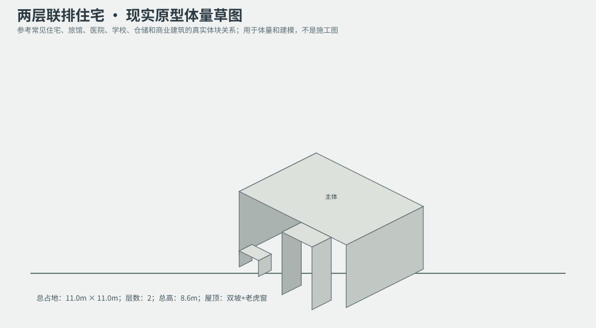
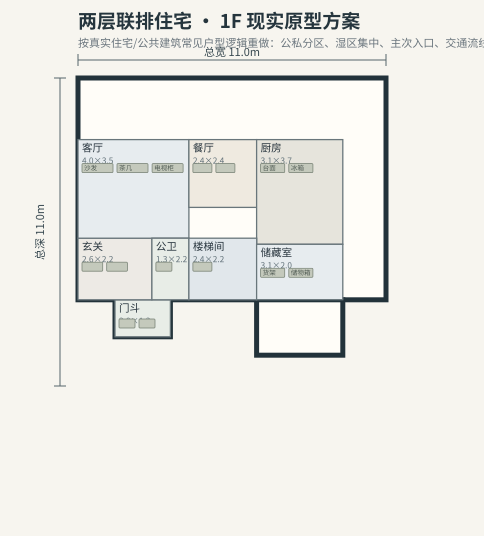
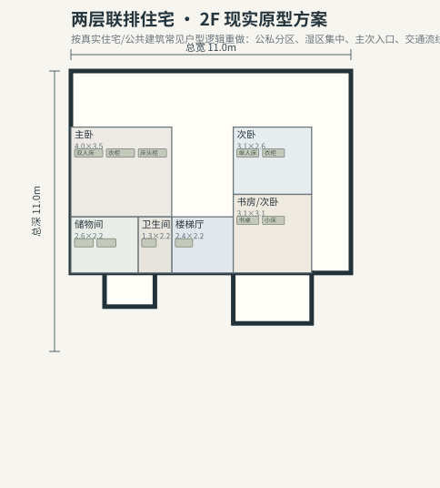

# BLD_004 · 两层联排住宅 — 现实原型重制说明

## 重制目标
本建筑按真实世界常见建筑原型重做，强调：体量变化、主次入口、公私分区、湿区集中、楼梯/电梯核、后勤空间、车库或设备翼、以及更合理的家具和动线。

## 基本参数
- 使用性质：居住
- 占地：11.0m × 11.0m
- 层数：2
- 总高：8.6m
- 屋顶：双坡+老虎窗
- 外立面：红砖/灰泥

## 分层布局

### 1F

| 空间 | 尺寸（米） | 家具/设施 | 现实依据与功能 |
|---|---|---|---|
| 门斗 | 2.0 × 1.3 | 鞋柜、换鞋凳 | 按真实房型功能组织 |
| 玄关 | 2.6 × 2.2 | 鞋柜、换鞋凳 | 按真实房型功能组织 |
| 客厅 | 4.0 × 3.5 | 沙发、茶几、电视柜 | 按真实房型功能组织 |
| 餐厅 | 2.4 × 2.4 | 餐桌、餐椅 | 按真实房型功能组织 |
| 厨房 | 3.1 × 3.7 | 台面、冰箱、水槽 | 湿区集中 |
| 公卫 | 1.3 × 2.2 | 马桶、洗手盆、淋浴间 | 按真实房型功能组织 |
| 楼梯间 | 2.4 × 2.2 | 楼梯 | 交通空间 |
| 储藏室 | 3.1 × 2.0 | 货架、储物箱 | 按真实房型功能组织 |

### 2F

| 空间 | 尺寸（米） | 家具/设施 | 现实依据与功能 |
|---|---|---|---|
| 楼梯厅 | 2.4 × 2.2 | 楼梯 | 交通空间 |
| 主卧 | 4.0 × 3.5 | 双人床、衣柜、床头柜 | 按真实房型功能组织 |
| 次卧 | 3.1 × 2.6 | 单人床、衣柜 | 按真实房型功能组织 |
| 书房/次卧 | 3.1 × 3.1 | 书桌、小床 | 按真实房型功能组织 |
| 卫生间 | 1.3 × 2.2 | 马桶、洗手盆、淋浴间 | 湿区集中 |
| 储物间 | 2.6 × 2.2 | 货架、储物箱 | 按真实房型功能组织 |

## 游戏实现建议
- 用门、窗、楼梯、电梯核和家具碰撞去驱动导航，而不是只看外轮廓。
- 体量图中的不同翼楼、附属房和门廊建议建成独立美术模块，便于LOD和损坏替换。
- 房间容器建议按用途绑定掉落池，如厨房、药房、后仓、设备间、宿舍、档案室等。
- 真实导向不等于过度复杂；仍需为AI寻路、玩家识别和性能服务。
