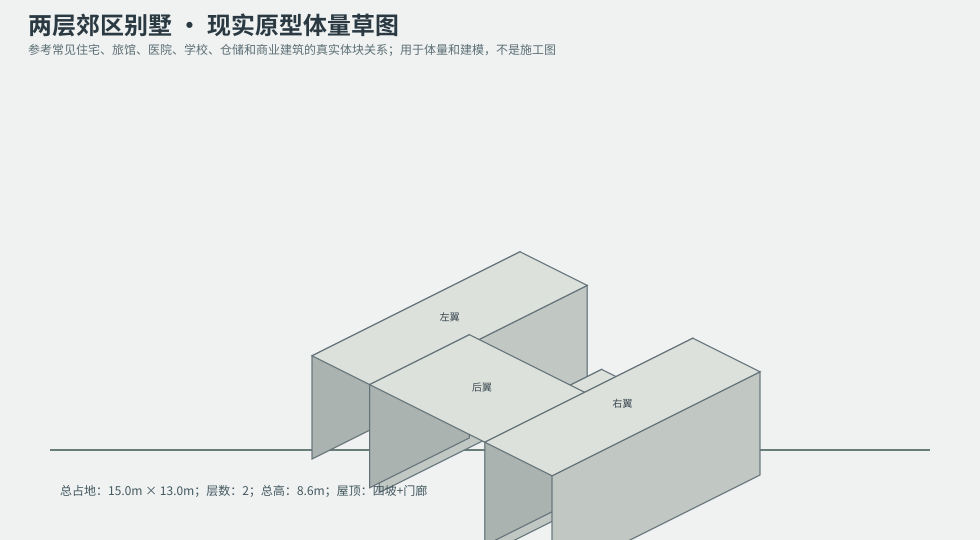
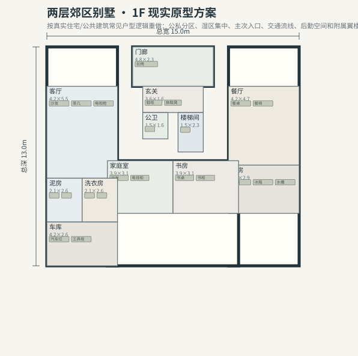
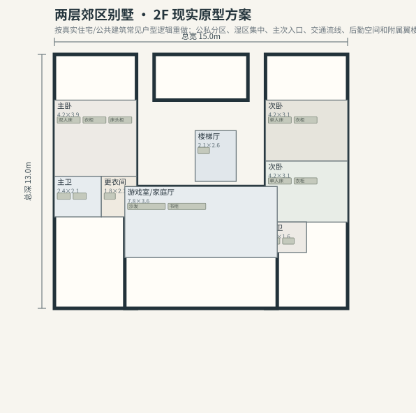

# BLD_005 · 两层郊区别墅 — 现实原型重制说明

## 重制目标
本建筑按真实世界常见建筑原型重做，强调：体量变化、主次入口、公私分区、湿区集中、楼梯/电梯核、后勤空间、车库或设备翼、以及更合理的家具和动线。

## 基本参数
- 使用性质：居住
- 占地：15.0m × 13.0m
- 层数：2
- 总高：8.6m
- 屋顶：四坡+门廊
- 外立面：米白灰泥/深瓦

## 分层布局

### 1F

| 空间 | 尺寸（米） | 家具/设施 | 现实依据与功能 |
|---|---|---|---|
| 门廊 | 4.8 × 2.3 | 长椅 | 按真实房型功能组织 |
| 玄关 | 3.6 × 1.6 | 鞋柜、换鞋凳 | 按真实房型功能组织 |
| 客厅 | 4.2 × 5.5 | 沙发、茶几、电视柜 | 按真实房型功能组织 |
| 餐厅 | 4.2 × 4.7 | 餐桌、餐椅 | 按真实房型功能组织 |
| 厨房 | 4.2 × 2.9 | 台面、冰箱、水槽 | 湿区集中 |
| 家庭室 | 3.9 × 3.1 | 沙发、电视柜 | 按真实房型功能组织 |
| 书房 | 3.9 × 3.1 | 书桌、书柜 | 按真实房型功能组织 |
| 泥房 | 2.1 × 2.6 | 鞋柜、换鞋凳 | 按真实房型功能组织 |
| 洗衣房 | 2.1 × 2.6 | 洗衣机、烘干机 | 湿区集中 |
| 车库 | 4.2 × 2.6 | 汽车位、工具柜 | 按真实房型功能组织 |
| 公卫 | 1.5 × 1.6 | 马桶、洗手盆、淋浴间 | 按真实房型功能组织 |
| 楼梯间 | 1.5 × 2.3 | 楼梯 | 交通空间 |

### 2F

| 空间 | 尺寸（米） | 家具/设施 | 现实依据与功能 |
|---|---|---|---|
| 楼梯厅 | 2.1 × 2.6 | 楼梯 | 交通空间 |
| 主卧 | 4.2 × 3.9 | 双人床、衣柜、床头柜 | 按真实房型功能组织 |
| 主卫 | 2.4 × 2.1 | 马桶、洗手盆、淋浴间 | 按真实房型功能组织 |
| 更衣间 | 1.8 × 2.1 | 衣柜 | 按真实房型功能组织 |
| 次卧 | 4.2 × 3.1 | 单人床、衣柜 | 按真实房型功能组织 |
| 次卧 | 4.2 × 3.1 | 单人床、衣柜 | 按真实房型功能组织 |
| 公卫 | 2.1 × 1.6 | 马桶、洗手盆、淋浴间 | 按真实房型功能组织 |
| 游戏室/家庭厅 | 7.8 × 3.6 | 沙发、书柜 | 按真实房型功能组织 |

## 游戏实现建议
- 用门、窗、楼梯、电梯核和家具碰撞去驱动导航，而不是只看外轮廓。
- 体量图中的不同翼楼、附属房和门廊建议建成独立美术模块，便于LOD和损坏替换。
- 房间容器建议按用途绑定掉落池，如厨房、药房、后仓、设备间、宿舍、档案室等。
- 真实导向不等于过度复杂；仍需为AI寻路、玩家识别和性能服务。
