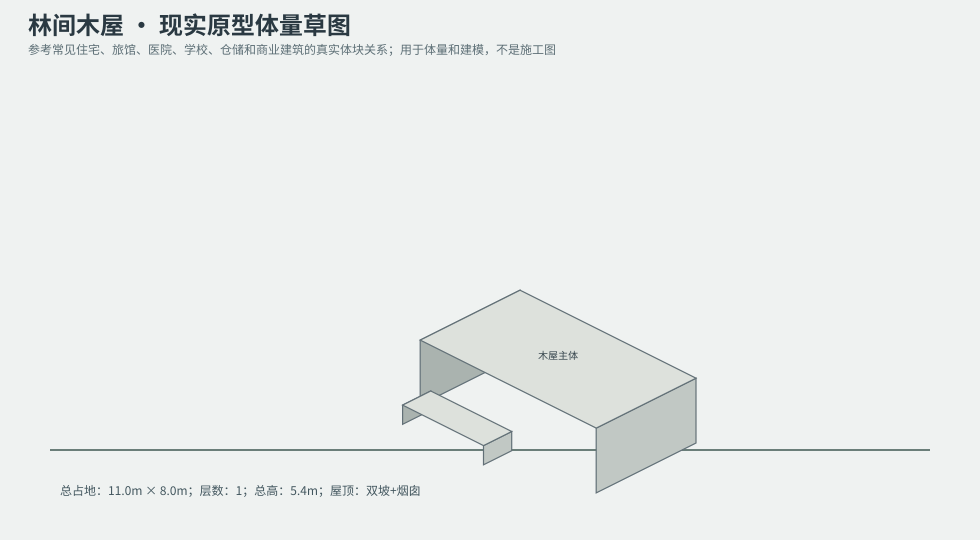
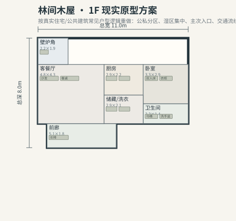

# BLD_007 · 林间木屋 — 现实原型重制说明

## 重制目标
本建筑按真实世界常见建筑原型重做，强调：体量变化、主次入口、公私分区、湿区集中、楼梯/电梯核、后勤空间、车库或设备翼、以及更合理的家具和动线。

## 基本参数
- 使用性质：居住
- 占地：11.0m × 8.0m
- 层数：1
- 总高：5.4m
- 屋顶：双坡+烟囱
- 外立面：木板/石材

## 分层布局

### 1F

| 空间 | 尺寸（米） | 家具/设施 | 现实依据与功能 |
|---|---|---|---|
| 前廊 | 5.1 × 1.8 | 长椅 | 按真实房型功能组织 |
| 客餐厅 | 4.8 × 4.3 | 沙发、餐桌 | 按真实房型功能组织 |
| 壁炉角 | 2.2 × 1.9 | 壁炉 | 按真实房型功能组织 |
| 厨房 | 2.9 × 2.2 | 台面、冰箱、水槽 | 湿区集中 |
| 卧室 | 3.3 × 2.9 | 双人床、衣柜、床头柜 | 按真实房型功能组织 |
| 卫生间 | 3.3 × 1.4 | 马桶、洗手盆、淋浴间 | 湿区集中 |
| 储藏/洗衣 | 2.9 × 2.1 | 洗衣机、烘干机 | 湿区集中 |

## 游戏实现建议
- 用门、窗、楼梯、电梯核和家具碰撞去驱动导航，而不是只看外轮廓。
- 体量图中的不同翼楼、附属房和门廊建议建成独立美术模块，便于LOD和损坏替换。
- 房间容器建议按用途绑定掉落池，如厨房、药房、后仓、设备间、宿舍、档案室等。
- 真实导向不等于过度复杂；仍需为AI寻路、玩家识别和性能服务。
