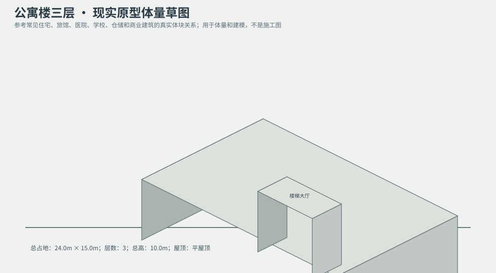
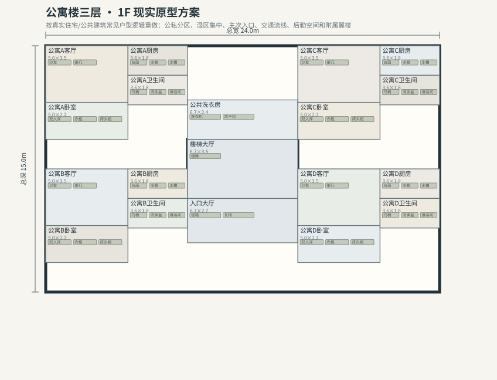
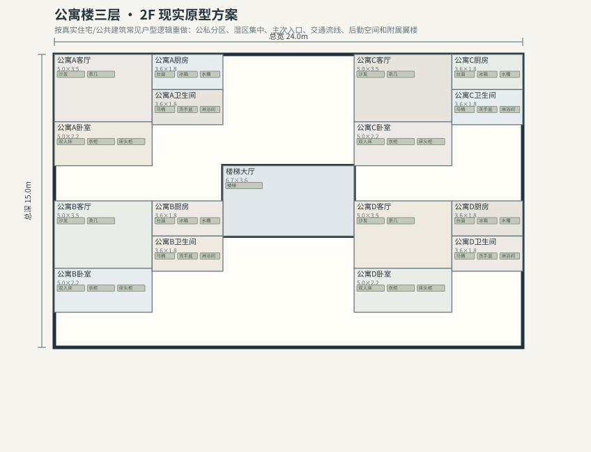

# BLD_009 · 公寓楼三层 — 现实原型重制说明

## 重制目标
本建筑按真实世界常见建筑原型重做，强调：体量变化、主次入口、公私分区、湿区集中、楼梯/电梯核、后勤空间、车库或设备翼、以及更合理的家具和动线。

## 基本参数
- 使用性质：公寓
- 占地：24.0m × 15.0m
- 层数：3
- 总高：10.0m
- 屋顶：平屋顶
- 外立面：混凝土/砖

## 分层布局

### 1F

| 空间 | 尺寸（米） | 家具/设施 | 现实依据与功能 |
|---|---|---|---|
| 入口大厅 | 6.7 × 2.7 | 信箱、长椅 | 交通空间 |
| 楼梯大厅 | 6.7 × 3.6 | 楼梯 | 交通空间 |
| 公共洗衣房 | 6.7 × 2.4 | 洗衣机、烘干机 | 湿区集中 |
| 公寓A客厅 | 5.0 × 3.5 | 沙发、茶几 | 按真实房型功能组织 |
| 公寓A厨房 | 3.6 × 1.8 | 台面、冰箱、水槽 | 湿区集中 |
| 公寓A卧室 | 5.0 × 2.2 | 双人床、衣柜、床头柜 | 按真实房型功能组织 |
| 公寓A卫生间 | 3.6 × 1.8 | 马桶、洗手盆、淋浴间 | 湿区集中 |
| 公寓B客厅 | 5.0 × 3.5 | 沙发、茶几 | 按真实房型功能组织 |
| 公寓B厨房 | 3.6 × 1.8 | 台面、冰箱、水槽 | 湿区集中 |
| 公寓B卧室 | 5.0 × 2.2 | 双人床、衣柜、床头柜 | 按真实房型功能组织 |
| 公寓B卫生间 | 3.6 × 1.8 | 马桶、洗手盆、淋浴间 | 湿区集中 |
| 公寓C客厅 | 5.0 × 3.5 | 沙发、茶几 | 按真实房型功能组织 |
| 公寓C厨房 | 3.6 × 1.8 | 台面、冰箱、水槽 | 湿区集中 |
| 公寓C卧室 | 5.0 × 2.2 | 双人床、衣柜、床头柜 | 按真实房型功能组织 |
| 公寓C卫生间 | 3.6 × 1.8 | 马桶、洗手盆、淋浴间 | 湿区集中 |
| 公寓D客厅 | 5.0 × 3.5 | 沙发、茶几 | 按真实房型功能组织 |
| 公寓D厨房 | 3.6 × 1.8 | 台面、冰箱、水槽 | 湿区集中 |
| 公寓D卧室 | 5.0 × 2.2 | 双人床、衣柜、床头柜 | 按真实房型功能组织 |
| 公寓D卫生间 | 3.6 × 1.8 | 马桶、洗手盆、淋浴间 | 湿区集中 |

### 2F

| 空间 | 尺寸（米） | 家具/设施 | 现实依据与功能 |
|---|---|---|---|
| 楼梯大厅 | 6.7 × 3.6 | 楼梯 | 交通空间 |
| 公寓A客厅 | 5.0 × 3.5 | 沙发、茶几 | 按真实房型功能组织 |
| 公寓A厨房 | 3.6 × 1.8 | 台面、冰箱、水槽 | 湿区集中 |
| 公寓A卧室 | 5.0 × 2.2 | 双人床、衣柜、床头柜 | 按真实房型功能组织 |
| 公寓A卫生间 | 3.6 × 1.8 | 马桶、洗手盆、淋浴间 | 湿区集中 |
| 公寓B客厅 | 5.0 × 3.5 | 沙发、茶几 | 按真实房型功能组织 |
| 公寓B厨房 | 3.6 × 1.8 | 台面、冰箱、水槽 | 湿区集中 |
| 公寓B卧室 | 5.0 × 2.2 | 双人床、衣柜、床头柜 | 按真实房型功能组织 |
| 公寓B卫生间 | 3.6 × 1.8 | 马桶、洗手盆、淋浴间 | 湿区集中 |
| 公寓C客厅 | 5.0 × 3.5 | 沙发、茶几 | 按真实房型功能组织 |
| 公寓C厨房 | 3.6 × 1.8 | 台面、冰箱、水槽 | 湿区集中 |
| 公寓C卧室 | 5.0 × 2.2 | 双人床、衣柜、床头柜 | 按真实房型功能组织 |
| 公寓C卫生间 | 3.6 × 1.8 | 马桶、洗手盆、淋浴间 | 湿区集中 |
| 公寓D客厅 | 5.0 × 3.5 | 沙发、茶几 | 按真实房型功能组织 |
| 公寓D厨房 | 3.6 × 1.8 | 台面、冰箱、水槽 | 湿区集中 |
| 公寓D卧室 | 5.0 × 2.2 | 双人床、衣柜、床头柜 | 按真实房型功能组织 |
| 公寓D卫生间 | 3.6 × 1.8 | 马桶、洗手盆、淋浴间 | 湿区集中 |

### 3F

| 空间 | 尺寸（米） | 家具/设施 | 现实依据与功能 |
|---|---|---|---|
| 楼梯大厅 | 6.7 × 3.6 | 楼梯 | 交通空间 |
| 公寓A客厅 | 5.0 × 3.5 | 沙发、茶几 | 按真实房型功能组织 |
| 公寓A厨房 | 3.6 × 1.8 | 台面、冰箱、水槽 | 湿区集中 |
| 公寓A卧室 | 5.0 × 2.2 | 双人床、衣柜、床头柜 | 按真实房型功能组织 |
| 公寓A卫生间 | 3.6 × 1.8 | 马桶、洗手盆、淋浴间 | 湿区集中 |
| 公寓B客厅 | 5.0 × 3.5 | 沙发、茶几 | 按真实房型功能组织 |
| 公寓B厨房 | 3.6 × 1.8 | 台面、冰箱、水槽 | 湿区集中 |
| 公寓B卧室 | 5.0 × 2.2 | 双人床、衣柜、床头柜 | 按真实房型功能组织 |
| 公寓B卫生间 | 3.6 × 1.8 | 马桶、洗手盆、淋浴间 | 湿区集中 |
| 公寓C客厅 | 5.0 × 3.5 | 沙发、茶几 | 按真实房型功能组织 |
| 公寓C厨房 | 3.6 × 1.8 | 台面、冰箱、水槽 | 湿区集中 |
| 公寓C卧室 | 5.0 × 2.2 | 双人床、衣柜、床头柜 | 按真实房型功能组织 |
| 公寓C卫生间 | 3.6 × 1.8 | 马桶、洗手盆、淋浴间 | 湿区集中 |
| 公寓D客厅 | 5.0 × 3.5 | 沙发、茶几 | 按真实房型功能组织 |
| 公寓D厨房 | 3.6 × 1.8 | 台面、冰箱、水槽 | 湿区集中 |
| 公寓D卧室 | 5.0 × 2.2 | 双人床、衣柜、床头柜 | 按真实房型功能组织 |
| 公寓D卫生间 | 3.6 × 1.8 | 马桶、洗手盆、淋浴间 | 湿区集中 |

## 游戏实现建议
- 用门、窗、楼梯、电梯核和家具碰撞去驱动导航，而不是只看外轮廓。
- 体量图中的不同翼楼、附属房和门廊建议建成独立美术模块，便于LOD和损坏替换。
- 房间容器建议按用途绑定掉落池，如厨房、药房、后仓、设备间、宿舍、档案室等。
- 真实导向不等于过度复杂；仍需为AI寻路、玩家识别和性能服务。
