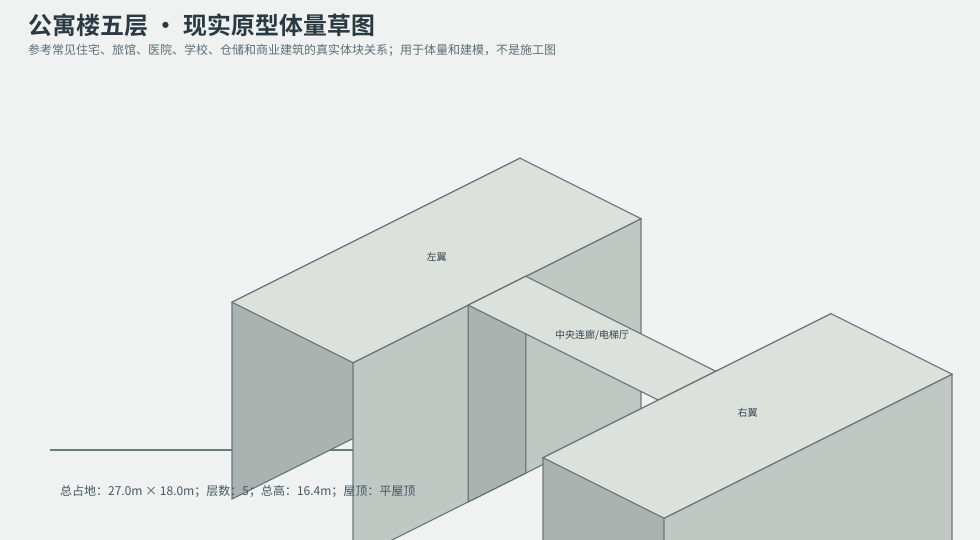
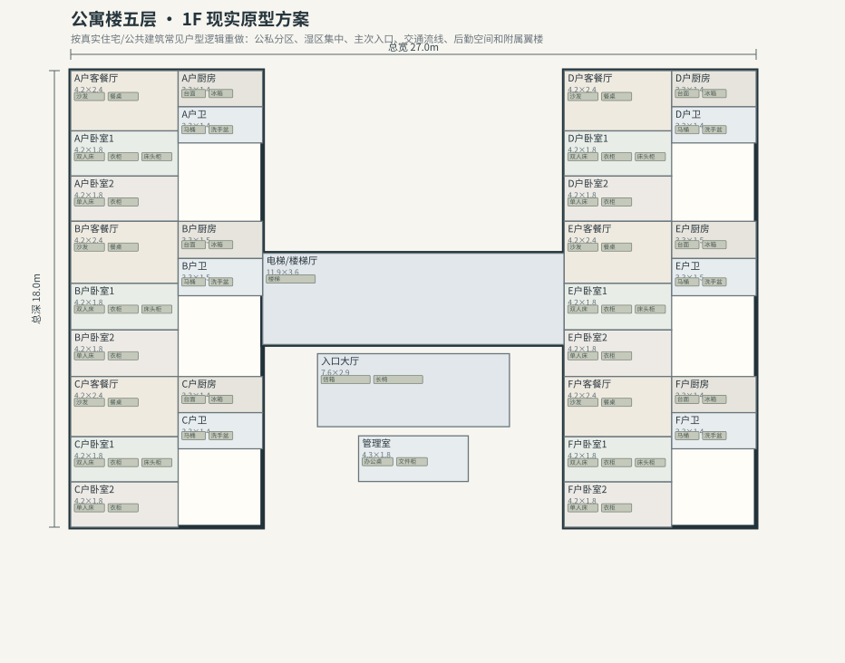
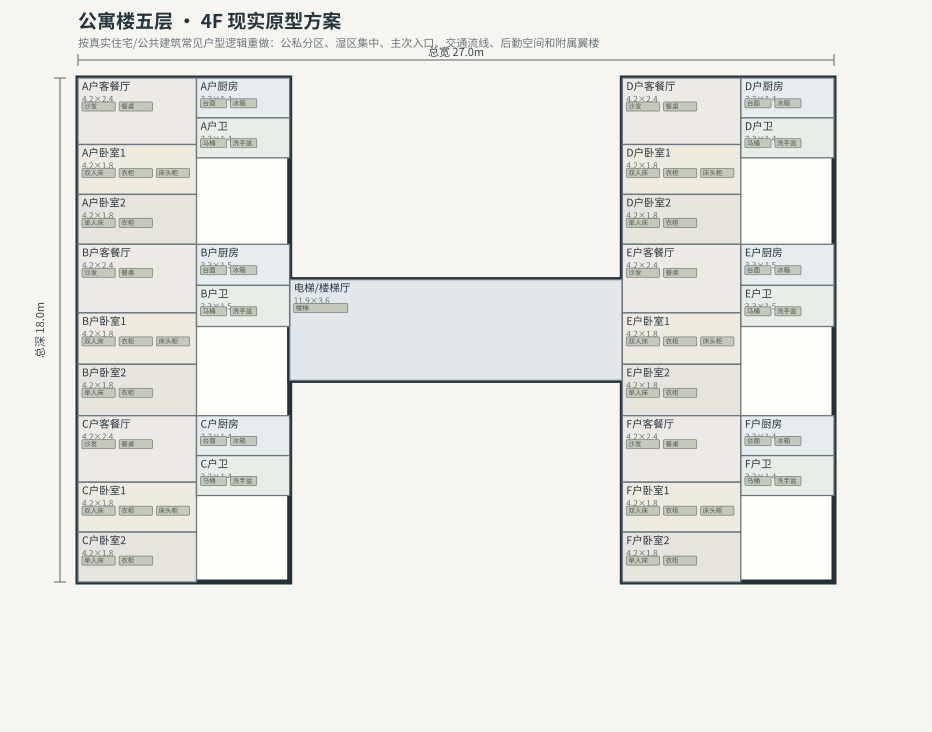

# BLD_010 · 公寓楼五层 — 现实原型重制说明

## 重制目标
本建筑按真实世界常见建筑原型重做，强调：体量变化、主次入口、公私分区、湿区集中、楼梯/电梯核、后勤空间、车库或设备翼、以及更合理的家具和动线。

## 基本参数
- 使用性质：公寓
- 占地：27.0m × 18.0m
- 层数：5
- 总高：16.4m
- 屋顶：平屋顶
- 外立面：砖墙/混凝土

## 分层布局

### 1F

| 空间 | 尺寸（米） | 家具/设施 | 现实依据与功能 |
|---|---|---|---|
| 入口大厅 | 7.6 × 2.9 | 信箱、长椅 | 交通空间 |
| 电梯/楼梯厅 | 11.9 × 3.6 | 楼梯 | 交通空间 |
| 管理室 | 4.3 × 1.8 | 办公桌、文件柜 | 按真实房型功能组织 |
| A户客餐厅 | 4.2 × 2.4 | 沙发、餐桌 | 按真实房型功能组织 |
| A户厨房 | 3.3 × 1.4 | 台面、冰箱、水槽 | 湿区集中 |
| A户卧室1 | 4.2 × 1.8 | 双人床、衣柜、床头柜 | 按真实房型功能组织 |
| A户卧室2 | 4.2 × 1.8 | 单人床、衣柜 | 按真实房型功能组织 |
| A户卫 | 3.3 × 1.4 | 马桶、洗手盆、淋浴间 | 按真实房型功能组织 |
| B户客餐厅 | 4.2 × 2.4 | 沙发、餐桌 | 按真实房型功能组织 |
| B户厨房 | 3.3 × 1.5 | 台面、冰箱、水槽 | 湿区集中 |
| B户卧室1 | 4.2 × 1.8 | 双人床、衣柜、床头柜 | 按真实房型功能组织 |
| B户卧室2 | 4.2 × 1.8 | 单人床、衣柜 | 按真实房型功能组织 |
| B户卫 | 3.3 × 1.5 | 马桶、洗手盆、淋浴间 | 按真实房型功能组织 |
| C户客餐厅 | 4.2 × 2.4 | 沙发、餐桌 | 按真实房型功能组织 |
| C户厨房 | 3.3 × 1.4 | 台面、冰箱、水槽 | 湿区集中 |
| C户卧室1 | 4.2 × 1.8 | 双人床、衣柜、床头柜 | 按真实房型功能组织 |
| C户卧室2 | 4.2 × 1.8 | 单人床、衣柜 | 按真实房型功能组织 |
| C户卫 | 3.3 × 1.4 | 马桶、洗手盆、淋浴间 | 按真实房型功能组织 |
| D户客餐厅 | 4.2 × 2.4 | 沙发、餐桌 | 按真实房型功能组织 |
| D户厨房 | 3.3 × 1.4 | 台面、冰箱、水槽 | 湿区集中 |
| D户卧室1 | 4.2 × 1.8 | 双人床、衣柜、床头柜 | 按真实房型功能组织 |
| D户卧室2 | 4.2 × 1.8 | 单人床、衣柜 | 按真实房型功能组织 |
| D户卫 | 3.3 × 1.4 | 马桶、洗手盆、淋浴间 | 按真实房型功能组织 |
| E户客餐厅 | 4.2 × 2.4 | 沙发、餐桌 | 按真实房型功能组织 |
| E户厨房 | 3.3 × 1.5 | 台面、冰箱、水槽 | 湿区集中 |
| E户卧室1 | 4.2 × 1.8 | 双人床、衣柜、床头柜 | 按真实房型功能组织 |
| E户卧室2 | 4.2 × 1.8 | 单人床、衣柜 | 按真实房型功能组织 |
| E户卫 | 3.3 × 1.5 | 马桶、洗手盆、淋浴间 | 按真实房型功能组织 |
| F户客餐厅 | 4.2 × 2.4 | 沙发、餐桌 | 按真实房型功能组织 |
| F户厨房 | 3.3 × 1.4 | 台面、冰箱、水槽 | 湿区集中 |
| F户卧室1 | 4.2 × 1.8 | 双人床、衣柜、床头柜 | 按真实房型功能组织 |
| F户卧室2 | 4.2 × 1.8 | 单人床、衣柜 | 按真实房型功能组织 |
| F户卫 | 3.3 × 1.4 | 马桶、洗手盆、淋浴间 | 按真实房型功能组织 |

### 2F

| 空间 | 尺寸（米） | 家具/设施 | 现实依据与功能 |
|---|---|---|---|
| 电梯/楼梯厅 | 11.9 × 3.6 | 楼梯 | 交通空间 |
| A户客餐厅 | 4.2 × 2.4 | 沙发、餐桌 | 按真实房型功能组织 |
| A户厨房 | 3.3 × 1.4 | 台面、冰箱、水槽 | 湿区集中 |
| A户卧室1 | 4.2 × 1.8 | 双人床、衣柜、床头柜 | 按真实房型功能组织 |
| A户卧室2 | 4.2 × 1.8 | 单人床、衣柜 | 按真实房型功能组织 |
| A户卫 | 3.3 × 1.4 | 马桶、洗手盆、淋浴间 | 按真实房型功能组织 |
| B户客餐厅 | 4.2 × 2.4 | 沙发、餐桌 | 按真实房型功能组织 |
| B户厨房 | 3.3 × 1.5 | 台面、冰箱、水槽 | 湿区集中 |
| B户卧室1 | 4.2 × 1.8 | 双人床、衣柜、床头柜 | 按真实房型功能组织 |
| B户卧室2 | 4.2 × 1.8 | 单人床、衣柜 | 按真实房型功能组织 |
| B户卫 | 3.3 × 1.5 | 马桶、洗手盆、淋浴间 | 按真实房型功能组织 |
| C户客餐厅 | 4.2 × 2.4 | 沙发、餐桌 | 按真实房型功能组织 |
| C户厨房 | 3.3 × 1.4 | 台面、冰箱、水槽 | 湿区集中 |
| C户卧室1 | 4.2 × 1.8 | 双人床、衣柜、床头柜 | 按真实房型功能组织 |
| C户卧室2 | 4.2 × 1.8 | 单人床、衣柜 | 按真实房型功能组织 |
| C户卫 | 3.3 × 1.4 | 马桶、洗手盆、淋浴间 | 按真实房型功能组织 |
| D户客餐厅 | 4.2 × 2.4 | 沙发、餐桌 | 按真实房型功能组织 |
| D户厨房 | 3.3 × 1.4 | 台面、冰箱、水槽 | 湿区集中 |
| D户卧室1 | 4.2 × 1.8 | 双人床、衣柜、床头柜 | 按真实房型功能组织 |
| D户卧室2 | 4.2 × 1.8 | 单人床、衣柜 | 按真实房型功能组织 |
| D户卫 | 3.3 × 1.4 | 马桶、洗手盆、淋浴间 | 按真实房型功能组织 |
| E户客餐厅 | 4.2 × 2.4 | 沙发、餐桌 | 按真实房型功能组织 |
| E户厨房 | 3.3 × 1.5 | 台面、冰箱、水槽 | 湿区集中 |
| E户卧室1 | 4.2 × 1.8 | 双人床、衣柜、床头柜 | 按真实房型功能组织 |
| E户卧室2 | 4.2 × 1.8 | 单人床、衣柜 | 按真实房型功能组织 |
| E户卫 | 3.3 × 1.5 | 马桶、洗手盆、淋浴间 | 按真实房型功能组织 |
| F户客餐厅 | 4.2 × 2.4 | 沙发、餐桌 | 按真实房型功能组织 |
| F户厨房 | 3.3 × 1.4 | 台面、冰箱、水槽 | 湿区集中 |
| F户卧室1 | 4.2 × 1.8 | 双人床、衣柜、床头柜 | 按真实房型功能组织 |
| F户卧室2 | 4.2 × 1.8 | 单人床、衣柜 | 按真实房型功能组织 |
| F户卫 | 3.3 × 1.4 | 马桶、洗手盆、淋浴间 | 按真实房型功能组织 |

### 3F

| 空间 | 尺寸（米） | 家具/设施 | 现实依据与功能 |
|---|---|---|---|
| 电梯/楼梯厅 | 11.9 × 3.6 | 楼梯 | 交通空间 |
| A户客餐厅 | 4.2 × 2.4 | 沙发、餐桌 | 按真实房型功能组织 |
| A户厨房 | 3.3 × 1.4 | 台面、冰箱、水槽 | 湿区集中 |
| A户卧室1 | 4.2 × 1.8 | 双人床、衣柜、床头柜 | 按真实房型功能组织 |
| A户卧室2 | 4.2 × 1.8 | 单人床、衣柜 | 按真实房型功能组织 |
| A户卫 | 3.3 × 1.4 | 马桶、洗手盆、淋浴间 | 按真实房型功能组织 |
| B户客餐厅 | 4.2 × 2.4 | 沙发、餐桌 | 按真实房型功能组织 |
| B户厨房 | 3.3 × 1.5 | 台面、冰箱、水槽 | 湿区集中 |
| B户卧室1 | 4.2 × 1.8 | 双人床、衣柜、床头柜 | 按真实房型功能组织 |
| B户卧室2 | 4.2 × 1.8 | 单人床、衣柜 | 按真实房型功能组织 |
| B户卫 | 3.3 × 1.5 | 马桶、洗手盆、淋浴间 | 按真实房型功能组织 |
| C户客餐厅 | 4.2 × 2.4 | 沙发、餐桌 | 按真实房型功能组织 |
| C户厨房 | 3.3 × 1.4 | 台面、冰箱、水槽 | 湿区集中 |
| C户卧室1 | 4.2 × 1.8 | 双人床、衣柜、床头柜 | 按真实房型功能组织 |
| C户卧室2 | 4.2 × 1.8 | 单人床、衣柜 | 按真实房型功能组织 |
| C户卫 | 3.3 × 1.4 | 马桶、洗手盆、淋浴间 | 按真实房型功能组织 |
| D户客餐厅 | 4.2 × 2.4 | 沙发、餐桌 | 按真实房型功能组织 |
| D户厨房 | 3.3 × 1.4 | 台面、冰箱、水槽 | 湿区集中 |
| D户卧室1 | 4.2 × 1.8 | 双人床、衣柜、床头柜 | 按真实房型功能组织 |
| D户卧室2 | 4.2 × 1.8 | 单人床、衣柜 | 按真实房型功能组织 |
| D户卫 | 3.3 × 1.4 | 马桶、洗手盆、淋浴间 | 按真实房型功能组织 |
| E户客餐厅 | 4.2 × 2.4 | 沙发、餐桌 | 按真实房型功能组织 |
| E户厨房 | 3.3 × 1.5 | 台面、冰箱、水槽 | 湿区集中 |
| E户卧室1 | 4.2 × 1.8 | 双人床、衣柜、床头柜 | 按真实房型功能组织 |
| E户卧室2 | 4.2 × 1.8 | 单人床、衣柜 | 按真实房型功能组织 |
| E户卫 | 3.3 × 1.5 | 马桶、洗手盆、淋浴间 | 按真实房型功能组织 |
| F户客餐厅 | 4.2 × 2.4 | 沙发、餐桌 | 按真实房型功能组织 |
| F户厨房 | 3.3 × 1.4 | 台面、冰箱、水槽 | 湿区集中 |
| F户卧室1 | 4.2 × 1.8 | 双人床、衣柜、床头柜 | 按真实房型功能组织 |
| F户卧室2 | 4.2 × 1.8 | 单人床、衣柜 | 按真实房型功能组织 |
| F户卫 | 3.3 × 1.4 | 马桶、洗手盆、淋浴间 | 按真实房型功能组织 |

### 4F

| 空间 | 尺寸（米） | 家具/设施 | 现实依据与功能 |
|---|---|---|---|
| 电梯/楼梯厅 | 11.9 × 3.6 | 楼梯 | 交通空间 |
| A户客餐厅 | 4.2 × 2.4 | 沙发、餐桌 | 按真实房型功能组织 |
| A户厨房 | 3.3 × 1.4 | 台面、冰箱、水槽 | 湿区集中 |
| A户卧室1 | 4.2 × 1.8 | 双人床、衣柜、床头柜 | 按真实房型功能组织 |
| A户卧室2 | 4.2 × 1.8 | 单人床、衣柜 | 按真实房型功能组织 |
| A户卫 | 3.3 × 1.4 | 马桶、洗手盆、淋浴间 | 按真实房型功能组织 |
| B户客餐厅 | 4.2 × 2.4 | 沙发、餐桌 | 按真实房型功能组织 |
| B户厨房 | 3.3 × 1.5 | 台面、冰箱、水槽 | 湿区集中 |
| B户卧室1 | 4.2 × 1.8 | 双人床、衣柜、床头柜 | 按真实房型功能组织 |
| B户卧室2 | 4.2 × 1.8 | 单人床、衣柜 | 按真实房型功能组织 |
| B户卫 | 3.3 × 1.5 | 马桶、洗手盆、淋浴间 | 按真实房型功能组织 |
| C户客餐厅 | 4.2 × 2.4 | 沙发、餐桌 | 按真实房型功能组织 |
| C户厨房 | 3.3 × 1.4 | 台面、冰箱、水槽 | 湿区集中 |
| C户卧室1 | 4.2 × 1.8 | 双人床、衣柜、床头柜 | 按真实房型功能组织 |
| C户卧室2 | 4.2 × 1.8 | 单人床、衣柜 | 按真实房型功能组织 |
| C户卫 | 3.3 × 1.4 | 马桶、洗手盆、淋浴间 | 按真实房型功能组织 |
| D户客餐厅 | 4.2 × 2.4 | 沙发、餐桌 | 按真实房型功能组织 |
| D户厨房 | 3.3 × 1.4 | 台面、冰箱、水槽 | 湿区集中 |
| D户卧室1 | 4.2 × 1.8 | 双人床、衣柜、床头柜 | 按真实房型功能组织 |
| D户卧室2 | 4.2 × 1.8 | 单人床、衣柜 | 按真实房型功能组织 |
| D户卫 | 3.3 × 1.4 | 马桶、洗手盆、淋浴间 | 按真实房型功能组织 |
| E户客餐厅 | 4.2 × 2.4 | 沙发、餐桌 | 按真实房型功能组织 |
| E户厨房 | 3.3 × 1.5 | 台面、冰箱、水槽 | 湿区集中 |
| E户卧室1 | 4.2 × 1.8 | 双人床、衣柜、床头柜 | 按真实房型功能组织 |
| E户卧室2 | 4.2 × 1.8 | 单人床、衣柜 | 按真实房型功能组织 |
| E户卫 | 3.3 × 1.5 | 马桶、洗手盆、淋浴间 | 按真实房型功能组织 |
| F户客餐厅 | 4.2 × 2.4 | 沙发、餐桌 | 按真实房型功能组织 |
| F户厨房 | 3.3 × 1.4 | 台面、冰箱、水槽 | 湿区集中 |
| F户卧室1 | 4.2 × 1.8 | 双人床、衣柜、床头柜 | 按真实房型功能组织 |
| F户卧室2 | 4.2 × 1.8 | 单人床、衣柜 | 按真实房型功能组织 |
| F户卫 | 3.3 × 1.4 | 马桶、洗手盆、淋浴间 | 按真实房型功能组织 |

### 5F

| 空间 | 尺寸（米） | 家具/设施 | 现实依据与功能 |
|---|---|---|---|
| 电梯/楼梯厅 | 11.9 × 3.6 | 楼梯 | 交通空间 |
| A户客餐厅 | 4.2 × 2.4 | 沙发、餐桌 | 按真实房型功能组织 |
| A户厨房 | 3.3 × 1.4 | 台面、冰箱、水槽 | 湿区集中 |
| A户卧室1 | 4.2 × 1.8 | 双人床、衣柜、床头柜 | 按真实房型功能组织 |
| A户卧室2 | 4.2 × 1.8 | 单人床、衣柜 | 按真实房型功能组织 |
| A户卫 | 3.3 × 1.4 | 马桶、洗手盆、淋浴间 | 按真实房型功能组织 |
| B户客餐厅 | 4.2 × 2.4 | 沙发、餐桌 | 按真实房型功能组织 |
| B户厨房 | 3.3 × 1.5 | 台面、冰箱、水槽 | 湿区集中 |
| B户卧室1 | 4.2 × 1.8 | 双人床、衣柜、床头柜 | 按真实房型功能组织 |
| B户卧室2 | 4.2 × 1.8 | 单人床、衣柜 | 按真实房型功能组织 |
| B户卫 | 3.3 × 1.5 | 马桶、洗手盆、淋浴间 | 按真实房型功能组织 |
| C户客餐厅 | 4.2 × 2.4 | 沙发、餐桌 | 按真实房型功能组织 |
| C户厨房 | 3.3 × 1.4 | 台面、冰箱、水槽 | 湿区集中 |
| C户卧室1 | 4.2 × 1.8 | 双人床、衣柜、床头柜 | 按真实房型功能组织 |
| C户卧室2 | 4.2 × 1.8 | 单人床、衣柜 | 按真实房型功能组织 |
| C户卫 | 3.3 × 1.4 | 马桶、洗手盆、淋浴间 | 按真实房型功能组织 |
| D户客餐厅 | 4.2 × 2.4 | 沙发、餐桌 | 按真实房型功能组织 |
| D户厨房 | 3.3 × 1.4 | 台面、冰箱、水槽 | 湿区集中 |
| D户卧室1 | 4.2 × 1.8 | 双人床、衣柜、床头柜 | 按真实房型功能组织 |
| D户卧室2 | 4.2 × 1.8 | 单人床、衣柜 | 按真实房型功能组织 |
| D户卫 | 3.3 × 1.4 | 马桶、洗手盆、淋浴间 | 按真实房型功能组织 |
| E户客餐厅 | 4.2 × 2.4 | 沙发、餐桌 | 按真实房型功能组织 |
| E户厨房 | 3.3 × 1.5 | 台面、冰箱、水槽 | 湿区集中 |
| E户卧室1 | 4.2 × 1.8 | 双人床、衣柜、床头柜 | 按真实房型功能组织 |
| E户卧室2 | 4.2 × 1.8 | 单人床、衣柜 | 按真实房型功能组织 |
| E户卫 | 3.3 × 1.5 | 马桶、洗手盆、淋浴间 | 按真实房型功能组织 |
| F户客餐厅 | 4.2 × 2.4 | 沙发、餐桌 | 按真实房型功能组织 |
| F户厨房 | 3.3 × 1.4 | 台面、冰箱、水槽 | 湿区集中 |
| F户卧室1 | 4.2 × 1.8 | 双人床、衣柜、床头柜 | 按真实房型功能组织 |
| F户卧室2 | 4.2 × 1.8 | 单人床、衣柜 | 按真实房型功能组织 |
| F户卫 | 3.3 × 1.4 | 马桶、洗手盆、淋浴间 | 按真实房型功能组织 |

## 游戏实现建议
- 用门、窗、楼梯、电梯核和家具碰撞去驱动导航，而不是只看外轮廓。
- 体量图中的不同翼楼、附属房和门廊建议建成独立美术模块，便于LOD和损坏替换。
- 房间容器建议按用途绑定掉落池，如厨房、药房、后仓、设备间、宿舍、档案室等。
- 真实导向不等于过度复杂；仍需为AI寻路、玩家识别和性能服务。
