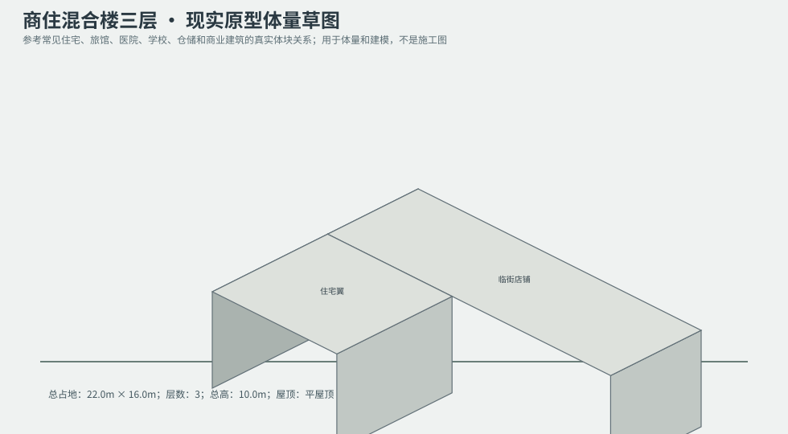
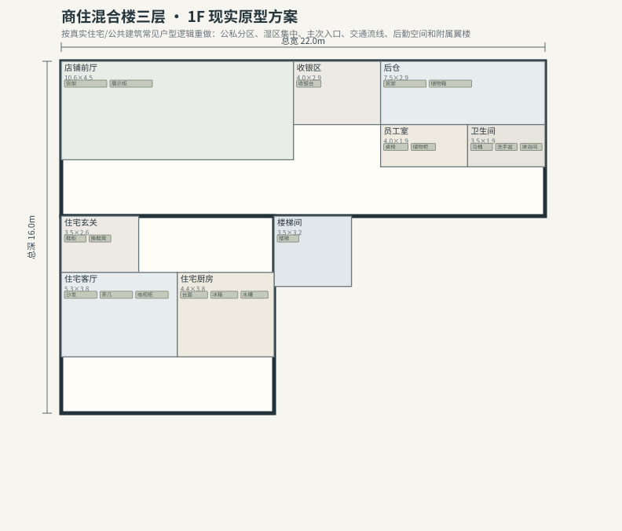
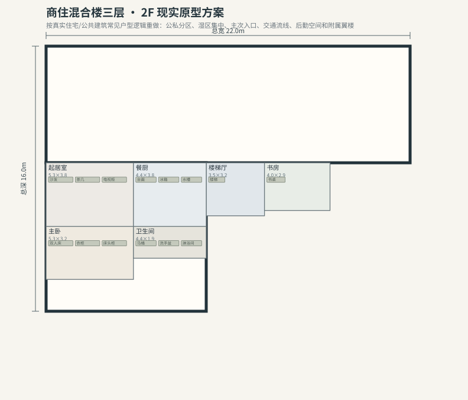
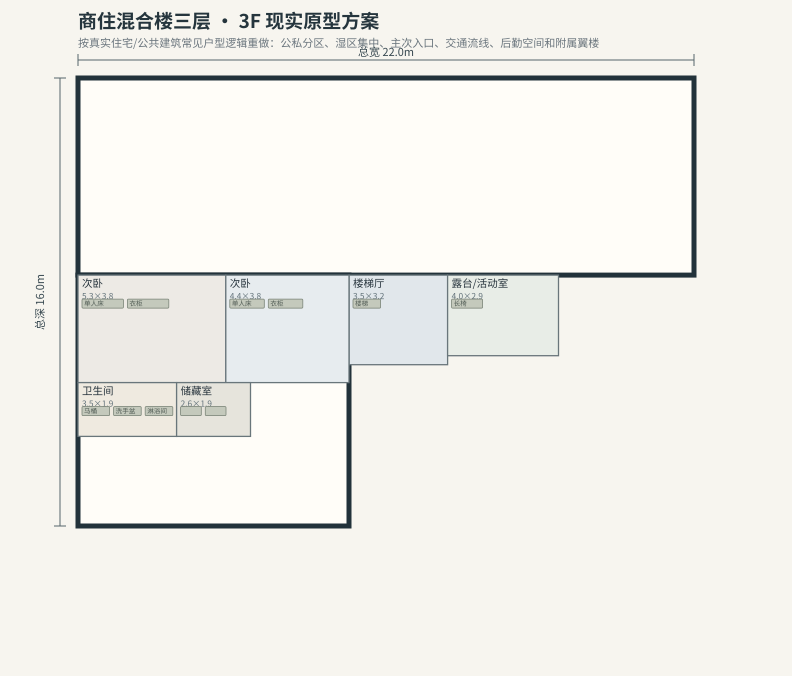

# BLD_011 · 商住混合楼三层 — 现实原型重制说明

## 重制目标
本建筑按真实世界常见建筑原型重做，强调：体量变化、主次入口、公私分区、湿区集中、楼梯/电梯核、后勤空间、车库或设备翼、以及更合理的家具和动线。

## 基本参数
- 使用性质：商住
- 占地：22.0m × 16.0m
- 层数：3
- 总高：10.0m
- 屋顶：平屋顶
- 外立面：红砖/深色门面

## 分层布局

### 1F

| 空间 | 尺寸（米） | 家具/设施 | 现实依据与功能 |
|---|---|---|---|
| 店铺前厅 | 10.6 × 4.5 | 货架、展示柜 | 按真实房型功能组织 |
| 收银区 | 4.0 × 2.9 | 收银台 | 按真实房型功能组织 |
| 后仓 | 7.5 × 2.9 | 货架、储物箱 | 按真实房型功能组织 |
| 员工室 | 4.0 × 1.9 | 桌椅、储物柜 | 按真实房型功能组织 |
| 卫生间 | 3.5 × 1.9 | 马桶、洗手盆、淋浴间 | 湿区集中 |
| 楼梯间 | 3.5 × 3.2 | 楼梯 | 交通空间 |
| 住宅玄关 | 3.5 × 2.6 | 鞋柜、换鞋凳 | 按真实房型功能组织 |
| 住宅客厅 | 5.3 × 3.8 | 沙发、茶几、电视柜 | 按真实房型功能组织 |
| 住宅厨房 | 4.4 × 3.8 | 台面、冰箱、水槽 | 湿区集中 |

### 2F

| 空间 | 尺寸（米） | 家具/设施 | 现实依据与功能 |
|---|---|---|---|
| 楼梯厅 | 3.5 × 3.2 | 楼梯 | 交通空间 |
| 起居室 | 5.3 × 3.8 | 沙发、茶几、电视柜 | 按真实房型功能组织 |
| 餐厨 | 4.4 × 3.8 | 台面、冰箱、水槽 | 按真实房型功能组织 |
| 主卧 | 5.3 × 3.2 | 双人床、衣柜、床头柜 | 按真实房型功能组织 |
| 卫生间 | 4.4 × 1.9 | 马桶、洗手盆、淋浴间 | 湿区集中 |
| 书房 | 4.0 × 2.9 | 书桌 | 按真实房型功能组织 |

### 3F

| 空间 | 尺寸（米） | 家具/设施 | 现实依据与功能 |
|---|---|---|---|
| 楼梯厅 | 3.5 × 3.2 | 楼梯 | 交通空间 |
| 次卧 | 5.3 × 3.8 | 单人床、衣柜 | 按真实房型功能组织 |
| 次卧 | 4.4 × 3.8 | 单人床、衣柜 | 按真实房型功能组织 |
| 卫生间 | 3.5 × 1.9 | 马桶、洗手盆、淋浴间 | 湿区集中 |
| 储藏室 | 2.6 × 1.9 | 货架、储物箱 | 按真实房型功能组织 |
| 露台/活动室 | 4.0 × 2.9 | 长椅 | 按真实房型功能组织 |

## 游戏实现建议
- 用门、窗、楼梯、电梯核和家具碰撞去驱动导航，而不是只看外轮廓。
- 体量图中的不同翼楼、附属房和门廊建议建成独立美术模块，便于LOD和损坏替换。
- 房间容器建议按用途绑定掉落池，如厨房、药房、后仓、设备间、宿舍、档案室等。
- 真实导向不等于过度复杂；仍需为AI寻路、玩家识别和性能服务。
