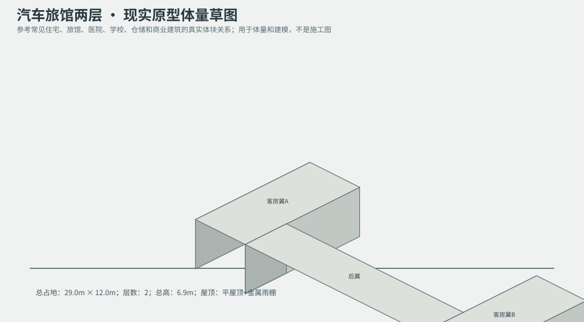
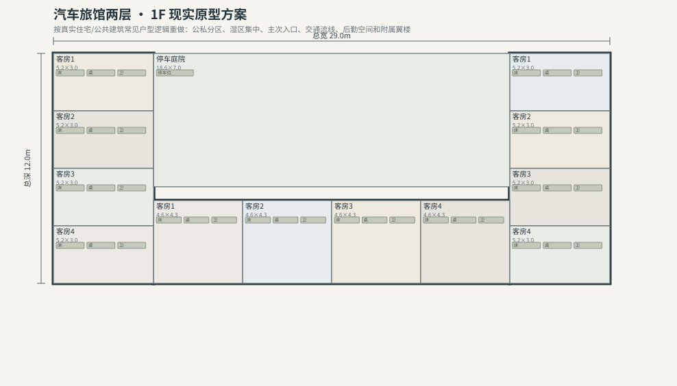
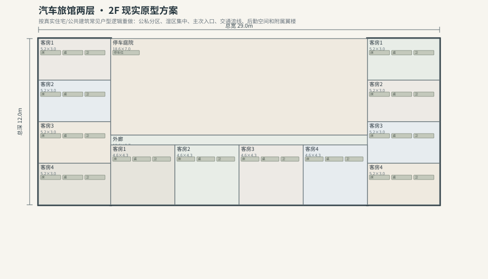

# BLD_012 · 汽车旅馆两层 — 现实原型重制说明

## 重制目标
本建筑按真实世界常见建筑原型重做，强调：体量变化、主次入口、公私分区、湿区集中、楼梯/电梯核、后勤空间、车库或设备翼、以及更合理的家具和动线。

## 基本参数
- 使用性质：旅馆
- 占地：29.0m × 12.0m
- 层数：2
- 总高：6.9m
- 屋顶：平屋顶+金属雨棚
- 外立面：混凝土/灰泥

## 分层布局

### 1F

| 空间 | 尺寸（米） | 家具/设施 | 现实依据与功能 |
|---|---|---|---|
| 接待前台 | 4.6 × 1.7 | 前台、办公室 | 按真实房型功能组织 |
| 布草间 | 3.5 × 1.2 | 货架、储物箱 | 按真实房型功能组织 |
| 清洁间 | 2.9 × 1.2 | 清洁车 | 按真实房型功能组织 |
| 客房1 | 5.2 × 3.0 | 床、桌、卫 | 按真实房型功能组织 |
| 客房2 | 5.2 × 3.0 | 床、桌、卫 | 按真实房型功能组织 |
| 客房3 | 5.2 × 3.0 | 床、桌、卫 | 按真实房型功能组织 |
| 客房4 | 5.2 × 3.0 | 床、桌、卫 | 按真实房型功能组织 |
| 客房1 | 5.2 × 3.0 | 床、桌、卫 | 按真实房型功能组织 |
| 客房2 | 5.2 × 3.0 | 床、桌、卫 | 按真实房型功能组织 |
| 客房3 | 5.2 × 3.0 | 床、桌、卫 | 按真实房型功能组织 |
| 客房4 | 5.2 × 3.0 | 床、桌、卫 | 按真实房型功能组织 |
| 客房1 | 4.6 × 4.3 | 床、桌、卫 | 按真实房型功能组织 |
| 客房2 | 4.6 × 4.3 | 床、桌、卫 | 按真实房型功能组织 |
| 客房3 | 4.6 × 4.3 | 床、桌、卫 | 按真实房型功能组织 |
| 客房4 | 4.6 × 4.3 | 床、桌、卫 | 按真实房型功能组织 |
| 停车庭院 | 18.6 × 7.0 | 停车位 | 按真实房型功能组织 |

### 2F

| 空间 | 尺寸（米） | 家具/设施 | 现实依据与功能 |
|---|---|---|---|
| 外廊 | 18.6 × 0.7 | 无 | 按真实房型功能组织 |
| 客房1 | 5.2 × 3.0 | 床、桌、卫 | 按真实房型功能组织 |
| 客房2 | 5.2 × 3.0 | 床、桌、卫 | 按真实房型功能组织 |
| 客房3 | 5.2 × 3.0 | 床、桌、卫 | 按真实房型功能组织 |
| 客房4 | 5.2 × 3.0 | 床、桌、卫 | 按真实房型功能组织 |
| 客房1 | 5.2 × 3.0 | 床、桌、卫 | 按真实房型功能组织 |
| 客房2 | 5.2 × 3.0 | 床、桌、卫 | 按真实房型功能组织 |
| 客房3 | 5.2 × 3.0 | 床、桌、卫 | 按真实房型功能组织 |
| 客房4 | 5.2 × 3.0 | 床、桌、卫 | 按真实房型功能组织 |
| 客房1 | 4.6 × 4.3 | 床、桌、卫 | 按真实房型功能组织 |
| 客房2 | 4.6 × 4.3 | 床、桌、卫 | 按真实房型功能组织 |
| 客房3 | 4.6 × 4.3 | 床、桌、卫 | 按真实房型功能组织 |
| 客房4 | 4.6 × 4.3 | 床、桌、卫 | 按真实房型功能组织 |
| 停车庭院 | 18.6 × 7.0 | 停车位 | 按真实房型功能组织 |

## 游戏实现建议
- 用门、窗、楼梯、电梯核和家具碰撞去驱动导航，而不是只看外轮廓。
- 体量图中的不同翼楼、附属房和门廊建议建成独立美术模块，便于LOD和损坏替换。
- 房间容器建议按用途绑定掉落池，如厨房、药房、后仓、设备间、宿舍、档案室等。
- 真实导向不等于过度复杂；仍需为AI寻路、玩家识别和性能服务。
