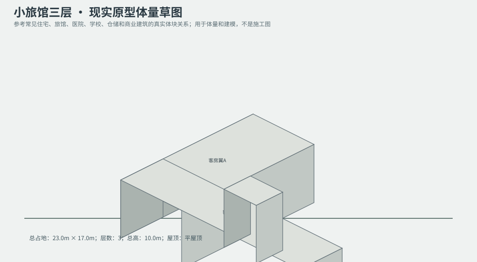
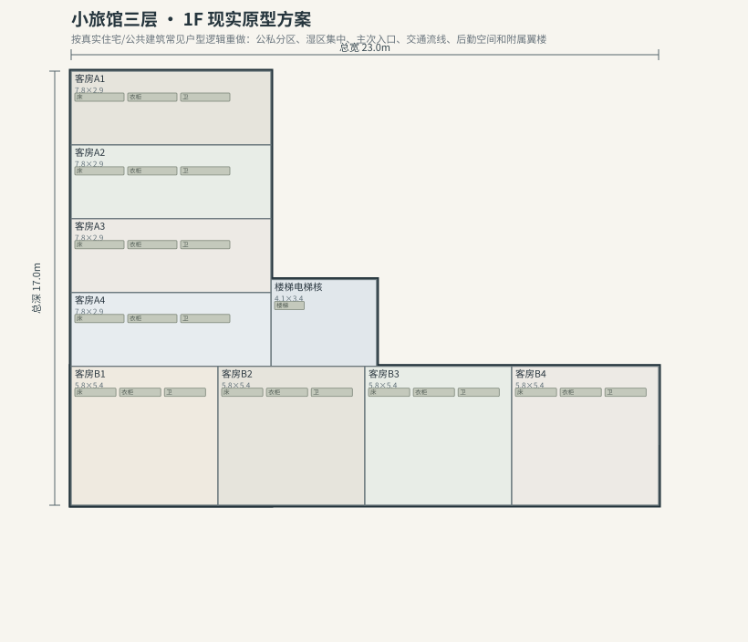
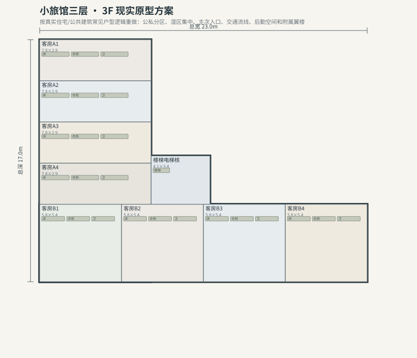

# BLD_013 · 小旅馆三层 — 现实原型重制说明

## 重制目标
本建筑按真实世界常见建筑原型重做，强调：体量变化、主次入口、公私分区、湿区集中、楼梯/电梯核、后勤空间、车库或设备翼、以及更合理的家具和动线。

## 基本参数
- 使用性质：旅馆
- 占地：23.0m × 17.0m
- 层数：3
- 总高：10.0m
- 屋顶：平屋顶
- 外立面：灰色灰泥/石材

## 分层布局

### 1F

| 空间 | 尺寸（米） | 家具/设施 | 现实依据与功能 |
|---|---|---|---|
| 大堂 | 5.5 × 3.1 | 沙发、前台 | 按真实房型功能组织 |
| 早餐区 | 4.1 × 3.1 | 餐桌 | 按真实房型功能组织 |
| 后勤/布草 | 5.5 × 3.1 | 货架、储物箱 | 按真实房型功能组织 |
| 楼梯电梯核 | 4.1 × 3.4 | 楼梯 | 交通空间 |
| 客房A1 | 7.8 × 2.9 | 床、衣柜、卫 | 按真实房型功能组织 |
| 客房A2 | 7.8 × 2.9 | 床、衣柜、卫 | 按真实房型功能组织 |
| 客房A3 | 7.8 × 2.9 | 床、衣柜、卫 | 按真实房型功能组织 |
| 客房A4 | 7.8 × 2.9 | 床、衣柜、卫 | 按真实房型功能组织 |
| 客房B1 | 5.8 × 5.4 | 床、衣柜、卫 | 按真实房型功能组织 |
| 客房B2 | 5.8 × 5.4 | 床、衣柜、卫 | 按真实房型功能组织 |
| 客房B3 | 5.8 × 5.4 | 床、衣柜、卫 | 按真实房型功能组织 |
| 客房B4 | 5.8 × 5.4 | 床、衣柜、卫 | 按真实房型功能组织 |

### 2F

| 空间 | 尺寸（米） | 家具/设施 | 现实依据与功能 |
|---|---|---|---|
| 楼梯电梯核 | 4.1 × 3.4 | 楼梯 | 交通空间 |
| 客房A1 | 7.8 × 2.9 | 床、衣柜、卫 | 按真实房型功能组织 |
| 客房A2 | 7.8 × 2.9 | 床、衣柜、卫 | 按真实房型功能组织 |
| 客房A3 | 7.8 × 2.9 | 床、衣柜、卫 | 按真实房型功能组织 |
| 客房A4 | 7.8 × 2.9 | 床、衣柜、卫 | 按真实房型功能组织 |
| 客房B1 | 5.8 × 5.4 | 床、衣柜、卫 | 按真实房型功能组织 |
| 客房B2 | 5.8 × 5.4 | 床、衣柜、卫 | 按真实房型功能组织 |
| 客房B3 | 5.8 × 5.4 | 床、衣柜、卫 | 按真实房型功能组织 |
| 客房B4 | 5.8 × 5.4 | 床、衣柜、卫 | 按真实房型功能组织 |

### 3F

| 空间 | 尺寸（米） | 家具/设施 | 现实依据与功能 |
|---|---|---|---|
| 楼梯电梯核 | 4.1 × 3.4 | 楼梯 | 交通空间 |
| 客房A1 | 7.8 × 2.9 | 床、衣柜、卫 | 按真实房型功能组织 |
| 客房A2 | 7.8 × 2.9 | 床、衣柜、卫 | 按真实房型功能组织 |
| 客房A3 | 7.8 × 2.9 | 床、衣柜、卫 | 按真实房型功能组织 |
| 客房A4 | 7.8 × 2.9 | 床、衣柜、卫 | 按真实房型功能组织 |
| 客房B1 | 5.8 × 5.4 | 床、衣柜、卫 | 按真实房型功能组织 |
| 客房B2 | 5.8 × 5.4 | 床、衣柜、卫 | 按真实房型功能组织 |
| 客房B3 | 5.8 × 5.4 | 床、衣柜、卫 | 按真实房型功能组织 |
| 客房B4 | 5.8 × 5.4 | 床、衣柜、卫 | 按真实房型功能组织 |

## 游戏实现建议
- 用门、窗、楼梯、电梯核和家具碰撞去驱动导航，而不是只看外轮廓。
- 体量图中的不同翼楼、附属房和门廊建议建成独立美术模块，便于LOD和损坏替换。
- 房间容器建议按用途绑定掉落池，如厨房、药房、后仓、设备间、宿舍、档案室等。
- 真实导向不等于过度复杂；仍需为AI寻路、玩家识别和性能服务。
