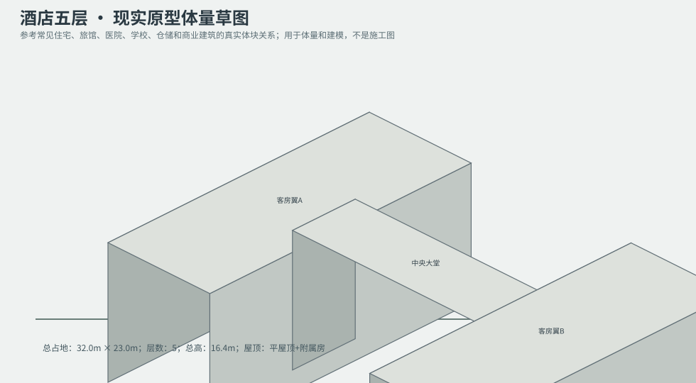
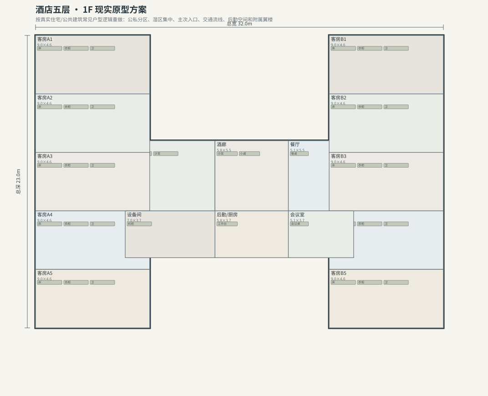
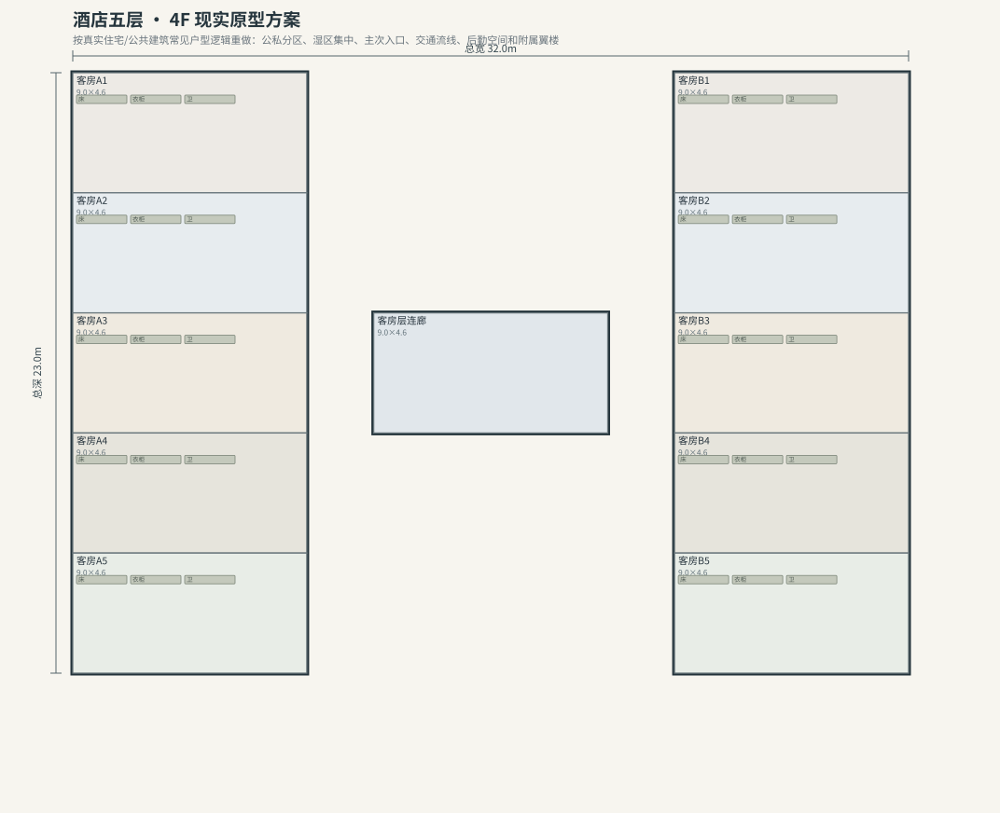

# BLD_014 · 酒店五层 — 现实原型重制说明

## 重制目标
本建筑按真实世界常见建筑原型重做，强调：体量变化、主次入口、公私分区、湿区集中、楼梯/电梯核、后勤空间、车库或设备翼、以及更合理的家具和动线。

## 基本参数
- 使用性质：旅馆
- 占地：32.0m × 23.0m
- 层数：5
- 总高：16.4m
- 屋顶：平屋顶+附属房
- 外立面：玻璃/混凝土

## 分层布局

### 1F

| 空间 | 尺寸（米） | 家具/设施 | 现实依据与功能 |
|---|---|---|---|
| 大堂 | 7.0 × 5.5 | 前台、沙发 | 按真实房型功能组织 |
| 酒廊 | 5.8 × 5.5 | 沙发、小桌 | 按真实房型功能组织 |
| 餐厅 | 5.1 × 5.5 | 餐桌 | 按真实房型功能组织 |
| 后勤/厨房 | 5.8 × 3.7 | 工作台 | 湿区集中 |
| 客房A1 | 9.0 × 4.6 | 床、衣柜、卫 | 按真实房型功能组织 |
| 客房A2 | 9.0 × 4.6 | 床、衣柜、卫 | 按真实房型功能组织 |
| 客房A3 | 9.0 × 4.6 | 床、衣柜、卫 | 按真实房型功能组织 |
| 客房A4 | 9.0 × 4.6 | 床、衣柜、卫 | 按真实房型功能组织 |
| 客房A5 | 9.0 × 4.6 | 床、衣柜、卫 | 按真实房型功能组织 |
| 客房B1 | 9.0 × 4.6 | 床、衣柜、卫 | 按真实房型功能组织 |
| 客房B2 | 9.0 × 4.6 | 床、衣柜、卫 | 按真实房型功能组织 |
| 客房B3 | 9.0 × 4.6 | 床、衣柜、卫 | 按真实房型功能组织 |
| 客房B4 | 9.0 × 4.6 | 床、衣柜、卫 | 按真实房型功能组织 |
| 客房B5 | 9.0 × 4.6 | 床、衣柜、卫 | 按真实房型功能组织 |
| 设备间 | 7.0 × 3.7 | 机柜 | 按真实房型功能组织 |
| 会议室 | 5.1 × 3.7 | 会议桌 | 按真实房型功能组织 |

### 2F

| 空间 | 尺寸（米） | 家具/设施 | 现实依据与功能 |
|---|---|---|---|
| 客房层连廊 | 9.0 × 4.6 | 无 | 交通空间 |
| 客房A1 | 9.0 × 4.6 | 床、衣柜、卫 | 按真实房型功能组织 |
| 客房A2 | 9.0 × 4.6 | 床、衣柜、卫 | 按真实房型功能组织 |
| 客房A3 | 9.0 × 4.6 | 床、衣柜、卫 | 按真实房型功能组织 |
| 客房A4 | 9.0 × 4.6 | 床、衣柜、卫 | 按真实房型功能组织 |
| 客房A5 | 9.0 × 4.6 | 床、衣柜、卫 | 按真实房型功能组织 |
| 客房B1 | 9.0 × 4.6 | 床、衣柜、卫 | 按真实房型功能组织 |
| 客房B2 | 9.0 × 4.6 | 床、衣柜、卫 | 按真实房型功能组织 |
| 客房B3 | 9.0 × 4.6 | 床、衣柜、卫 | 按真实房型功能组织 |
| 客房B4 | 9.0 × 4.6 | 床、衣柜、卫 | 按真实房型功能组织 |
| 客房B5 | 9.0 × 4.6 | 床、衣柜、卫 | 按真实房型功能组织 |

### 3F

| 空间 | 尺寸（米） | 家具/设施 | 现实依据与功能 |
|---|---|---|---|
| 客房层连廊 | 9.0 × 4.6 | 无 | 交通空间 |
| 客房A1 | 9.0 × 4.6 | 床、衣柜、卫 | 按真实房型功能组织 |
| 客房A2 | 9.0 × 4.6 | 床、衣柜、卫 | 按真实房型功能组织 |
| 客房A3 | 9.0 × 4.6 | 床、衣柜、卫 | 按真实房型功能组织 |
| 客房A4 | 9.0 × 4.6 | 床、衣柜、卫 | 按真实房型功能组织 |
| 客房A5 | 9.0 × 4.6 | 床、衣柜、卫 | 按真实房型功能组织 |
| 客房B1 | 9.0 × 4.6 | 床、衣柜、卫 | 按真实房型功能组织 |
| 客房B2 | 9.0 × 4.6 | 床、衣柜、卫 | 按真实房型功能组织 |
| 客房B3 | 9.0 × 4.6 | 床、衣柜、卫 | 按真实房型功能组织 |
| 客房B4 | 9.0 × 4.6 | 床、衣柜、卫 | 按真实房型功能组织 |
| 客房B5 | 9.0 × 4.6 | 床、衣柜、卫 | 按真实房型功能组织 |

### 4F

| 空间 | 尺寸（米） | 家具/设施 | 现实依据与功能 |
|---|---|---|---|
| 客房层连廊 | 9.0 × 4.6 | 无 | 交通空间 |
| 客房A1 | 9.0 × 4.6 | 床、衣柜、卫 | 按真实房型功能组织 |
| 客房A2 | 9.0 × 4.6 | 床、衣柜、卫 | 按真实房型功能组织 |
| 客房A3 | 9.0 × 4.6 | 床、衣柜、卫 | 按真实房型功能组织 |
| 客房A4 | 9.0 × 4.6 | 床、衣柜、卫 | 按真实房型功能组织 |
| 客房A5 | 9.0 × 4.6 | 床、衣柜、卫 | 按真实房型功能组织 |
| 客房B1 | 9.0 × 4.6 | 床、衣柜、卫 | 按真实房型功能组织 |
| 客房B2 | 9.0 × 4.6 | 床、衣柜、卫 | 按真实房型功能组织 |
| 客房B3 | 9.0 × 4.6 | 床、衣柜、卫 | 按真实房型功能组织 |
| 客房B4 | 9.0 × 4.6 | 床、衣柜、卫 | 按真实房型功能组织 |
| 客房B5 | 9.0 × 4.6 | 床、衣柜、卫 | 按真实房型功能组织 |

### 5F

| 空间 | 尺寸（米） | 家具/设施 | 现实依据与功能 |
|---|---|---|---|
| 客房层连廊 | 9.0 × 4.6 | 无 | 交通空间 |
| 客房A1 | 9.0 × 4.6 | 床、衣柜、卫 | 按真实房型功能组织 |
| 客房A2 | 9.0 × 4.6 | 床、衣柜、卫 | 按真实房型功能组织 |
| 客房A3 | 9.0 × 4.6 | 床、衣柜、卫 | 按真实房型功能组织 |
| 客房A4 | 9.0 × 4.6 | 床、衣柜、卫 | 按真实房型功能组织 |
| 客房A5 | 9.0 × 4.6 | 床、衣柜、卫 | 按真实房型功能组织 |
| 客房B1 | 9.0 × 4.6 | 床、衣柜、卫 | 按真实房型功能组织 |
| 客房B2 | 9.0 × 4.6 | 床、衣柜、卫 | 按真实房型功能组织 |
| 客房B3 | 9.0 × 4.6 | 床、衣柜、卫 | 按真实房型功能组织 |
| 客房B4 | 9.0 × 4.6 | 床、衣柜、卫 | 按真实房型功能组织 |
| 客房B5 | 9.0 × 4.6 | 床、衣柜、卫 | 按真实房型功能组织 |

## 游戏实现建议
- 用门、窗、楼梯、电梯核和家具碰撞去驱动导航，而不是只看外轮廓。
- 体量图中的不同翼楼、附属房和门廊建议建成独立美术模块，便于LOD和损坏替换。
- 房间容器建议按用途绑定掉落池，如厨房、药房、后仓、设备间、宿舍、档案室等。
- 真实导向不等于过度复杂；仍需为AI寻路、玩家识别和性能服务。
