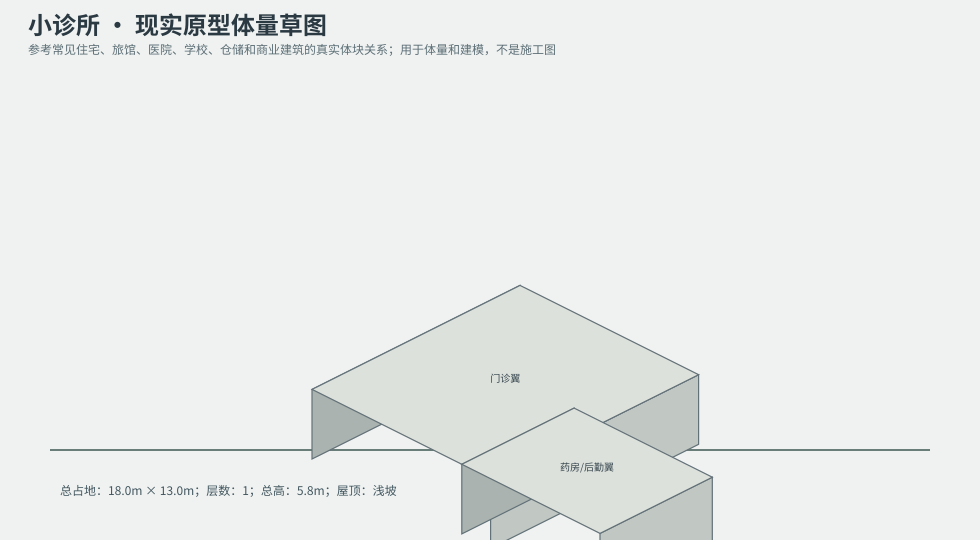
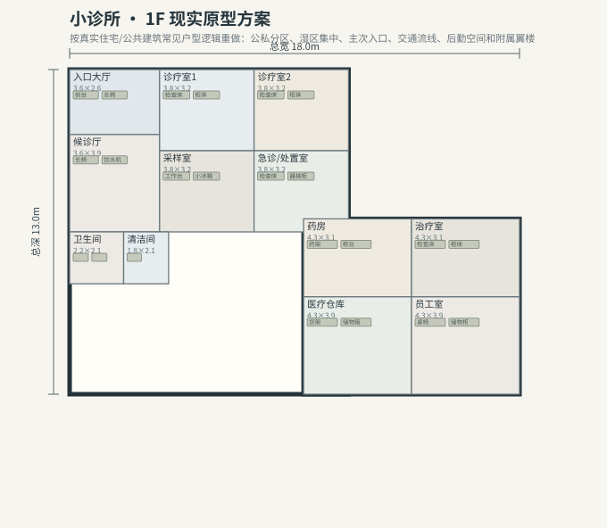

# BLD_015 · 小诊所 — 现实原型重制说明

## 重制目标
本建筑按真实世界常见建筑原型重做，强调：体量变化、主次入口、公私分区、湿区集中、楼梯/电梯核、后勤空间、车库或设备翼、以及更合理的家具和动线。

## 基本参数
- 使用性质：医疗
- 占地：18.0m × 13.0m
- 层数：1
- 总高：5.8m
- 屋顶：浅坡
- 外立面：白灰泥/蓝灰金属

## 分层布局

### 1F

| 空间 | 尺寸（米） | 家具/设施 | 现实依据与功能 |
|---|---|---|---|
| 入口大厅 | 3.6 × 2.6 | 前台、长椅 | 交通空间 |
| 候诊厅 | 3.6 × 3.9 | 长椅、饮水机 | 按真实房型功能组织 |
| 诊疗室1 | 3.8 × 3.2 | 检查床、柜体 | 按真实房型功能组织 |
| 诊疗室2 | 3.8 × 3.2 | 检查床、柜体 | 按真实房型功能组织 |
| 采样室 | 3.8 × 3.2 | 工作台、小冰箱 | 按真实房型功能组织 |
| 急诊/处置室 | 3.8 × 3.2 | 检查床、器械柜 | 按真实房型功能组织 |
| 卫生间 | 2.2 × 2.1 | 马桶、洗手盆、淋浴间 | 湿区集中 |
| 清洁间 | 1.8 × 2.1 | 水池 | 按真实房型功能组织 |
| 药房 | 4.3 × 3.1 | 药架、柜台 | 按真实房型功能组织 |
| 治疗室 | 4.3 × 3.1 | 检查床、柜体 | 按真实房型功能组织 |
| 医疗仓库 | 4.3 × 3.9 | 货架、储物箱 | 按真实房型功能组织 |
| 员工室 | 4.3 × 3.9 | 桌椅、储物柜 | 按真实房型功能组织 |

## 游戏实现建议
- 用门、窗、楼梯、电梯核和家具碰撞去驱动导航，而不是只看外轮廓。
- 体量图中的不同翼楼、附属房和门廊建议建成独立美术模块，便于LOD和损坏替换。
- 房间容器建议按用途绑定掉落池，如厨房、药房、后仓、设备间、宿舍、档案室等。
- 真实导向不等于过度复杂；仍需为AI寻路、玩家识别和性能服务。
