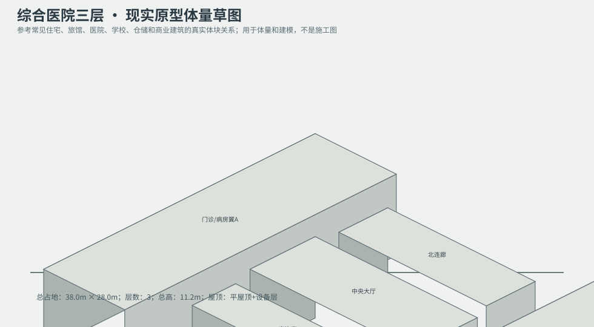
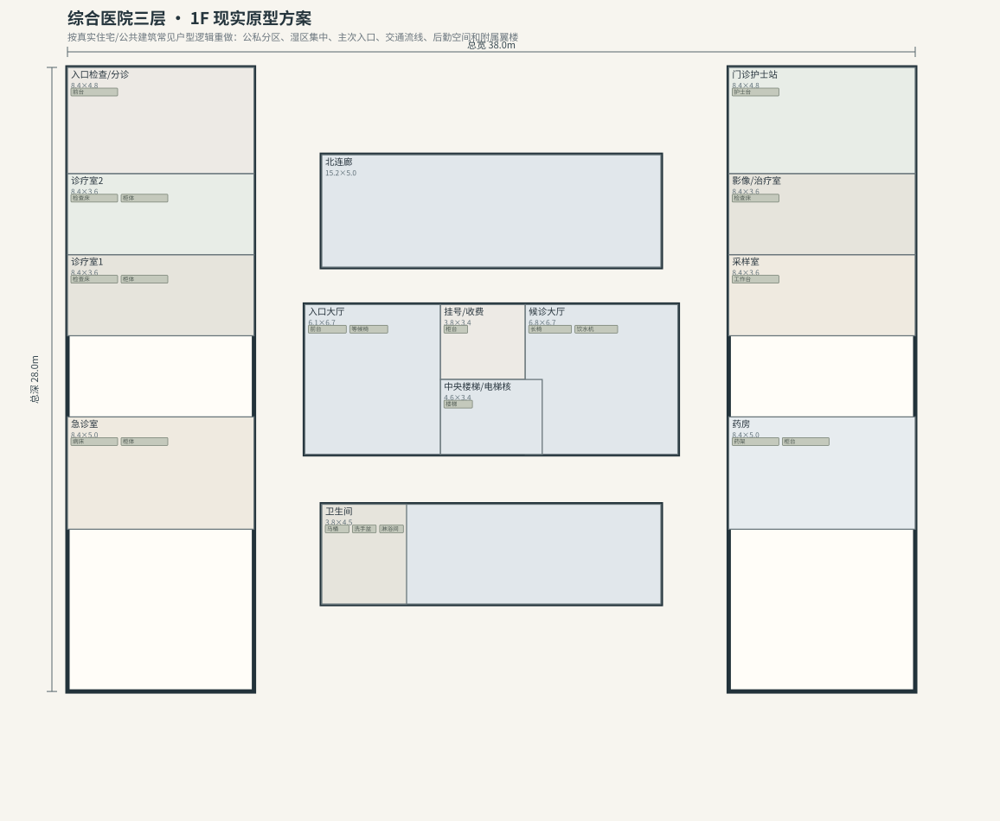
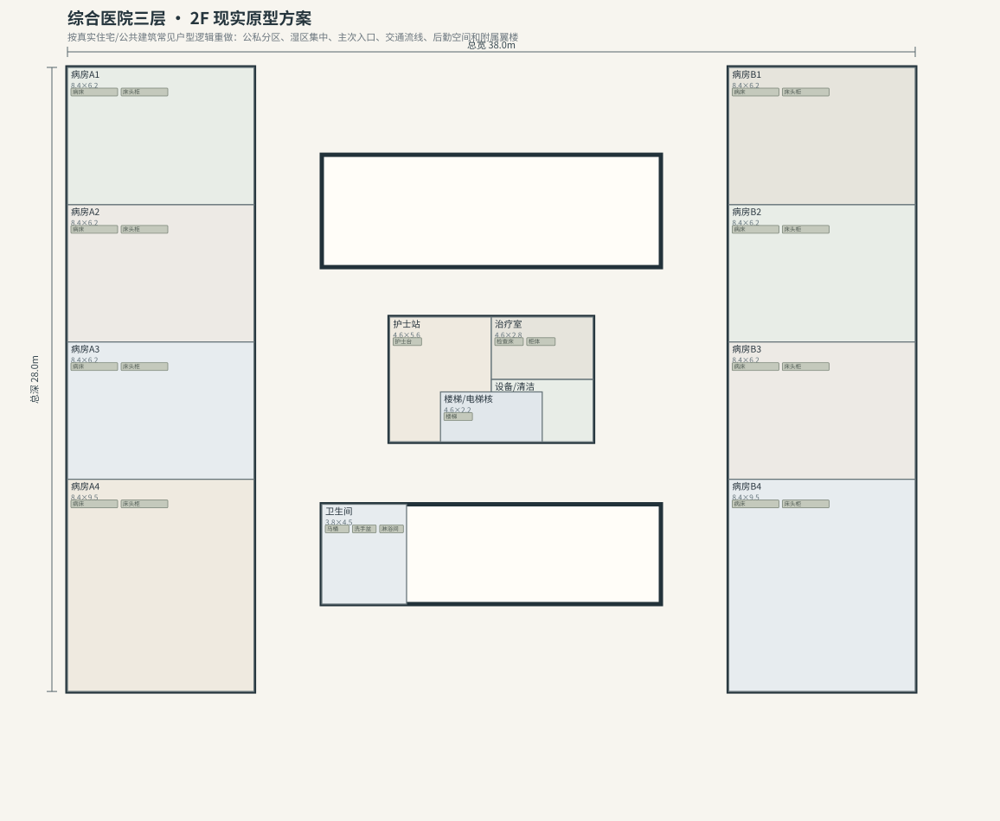
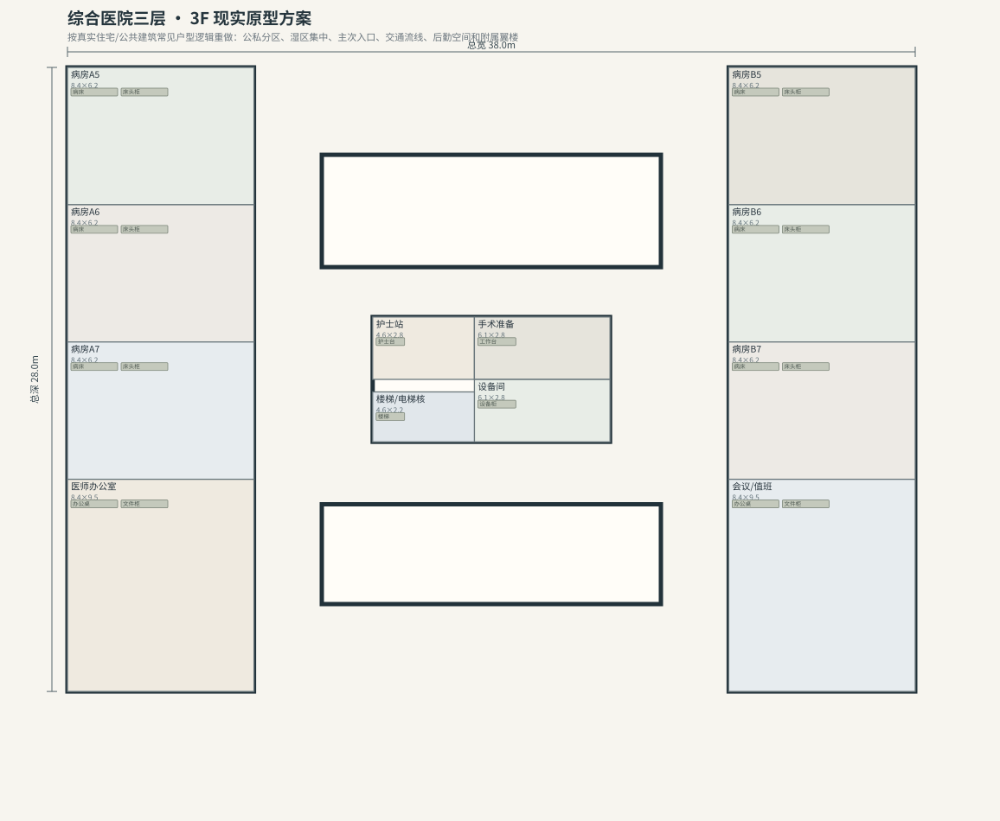

# BLD_016 · 综合医院三层 — 现实原型重制说明

## 重制目标
本建筑按真实世界常见建筑原型重做，强调：体量变化、主次入口、公私分区、湿区集中、楼梯/电梯核、后勤空间、车库或设备翼、以及更合理的家具和动线。

## 基本参数
- 使用性质：医疗
- 占地：38.0m × 28.0m
- 层数：3
- 总高：11.2m
- 屋顶：平屋顶+设备层
- 外立面：混凝土/玻璃

## 分层布局

### 1F

| 空间 | 尺寸（米） | 家具/设施 | 现实依据与功能 |
|---|---|---|---|
| 入口大厅 | 6.1 × 6.7 | 前台、等候椅 | 交通空间 |
| 挂号/收费 | 3.8 × 3.4 | 柜台 | 按真实房型功能组织 |
| 候诊大厅 | 6.8 × 6.7 | 长椅、饮水机 | 交通空间 |
| 急诊室 | 8.4 × 5.0 | 病床、柜体 | 按真实房型功能组织 |
| 诊疗室1 | 8.4 × 3.6 | 检查床、柜体 | 按真实房型功能组织 |
| 诊疗室2 | 8.4 × 3.6 | 检查床、柜体 | 按真实房型功能组织 |
| 入口检查/分诊 | 8.4 × 4.8 | 前台 | 按真实房型功能组织 |
| 药房 | 8.4 × 5.0 | 药架、柜台 | 按真实房型功能组织 |
| 采样室 | 8.4 × 3.6 | 工作台 | 按真实房型功能组织 |
| 影像/治疗室 | 8.4 × 3.6 | 检查床 | 按真实房型功能组织 |
| 门诊护士站 | 8.4 × 4.8 | 护士台 | 按真实房型功能组织 |
| 北连廊 | 15.2 × 5.0 | 无 | 交通空间 |
| 南连廊 | 15.2 × 4.5 | 无 | 交通空间 |
| 中央楼梯/电梯核 | 4.6 × 3.4 | 楼梯 | 交通空间 |
| 卫生间 | 3.8 × 4.5 | 马桶、洗手盆、淋浴间 | 湿区集中 |

### 2F

| 空间 | 尺寸（米） | 家具/设施 | 现实依据与功能 |
|---|---|---|---|
| 病房A1 | 8.4 × 6.2 | 病床、床头柜 | 按真实房型功能组织 |
| 病房A2 | 8.4 × 6.2 | 病床、床头柜 | 按真实房型功能组织 |
| 病房A3 | 8.4 × 6.2 | 病床、床头柜 | 按真实房型功能组织 |
| 病房A4 | 8.4 × 9.5 | 病床、床头柜 | 按真实房型功能组织 |
| 病房B1 | 8.4 × 6.2 | 病床、床头柜 | 按真实房型功能组织 |
| 病房B2 | 8.4 × 6.2 | 病床、床头柜 | 按真实房型功能组织 |
| 病房B3 | 8.4 × 6.2 | 病床、床头柜 | 按真实房型功能组织 |
| 病房B4 | 8.4 × 9.5 | 病床、床头柜 | 按真实房型功能组织 |
| 护士站 | 4.6 × 5.6 | 护士台 | 按真实房型功能组织 |
| 治疗室 | 4.6 × 2.8 | 检查床、柜体 | 按真实房型功能组织 |
| 设备/清洁 | 4.6 × 2.8 | 器械柜 | 按真实房型功能组织 |
| 楼梯/电梯核 | 4.6 × 2.2 | 楼梯 | 交通空间 |
| 卫生间 | 3.8 × 4.5 | 马桶、洗手盆、淋浴间 | 湿区集中 |

### 3F

| 空间 | 尺寸（米） | 家具/设施 | 现实依据与功能 |
|---|---|---|---|
| 病房A5 | 8.4 × 6.2 | 病床、床头柜 | 按真实房型功能组织 |
| 病房A6 | 8.4 × 6.2 | 病床、床头柜 | 按真实房型功能组织 |
| 病房A7 | 8.4 × 6.2 | 病床、床头柜 | 按真实房型功能组织 |
| 医师办公室 | 8.4 × 9.5 | 办公桌、文件柜 | 按真实房型功能组织 |
| 病房B5 | 8.4 × 6.2 | 病床、床头柜 | 按真实房型功能组织 |
| 病房B6 | 8.4 × 6.2 | 病床、床头柜 | 按真实房型功能组织 |
| 病房B7 | 8.4 × 6.2 | 病床、床头柜 | 按真实房型功能组织 |
| 会议/值班 | 8.4 × 9.5 | 办公桌、文件柜 | 按真实房型功能组织 |
| 护士站 | 4.6 × 2.8 | 护士台 | 按真实房型功能组织 |
| 手术准备 | 6.1 × 2.8 | 工作台 | 按真实房型功能组织 |
| 设备间 | 6.1 × 2.8 | 设备柜 | 按真实房型功能组织 |
| 楼梯/电梯核 | 4.6 × 2.2 | 楼梯 | 交通空间 |

## 游戏实现建议
- 用门、窗、楼梯、电梯核和家具碰撞去驱动导航，而不是只看外轮廓。
- 体量图中的不同翼楼、附属房和门廊建议建成独立美术模块，便于LOD和损坏替换。
- 房间容器建议按用途绑定掉落池，如厨房、药房、后仓、设备间、宿舍、档案室等。
- 真实导向不等于过度复杂；仍需为AI寻路、玩家识别和性能服务。
