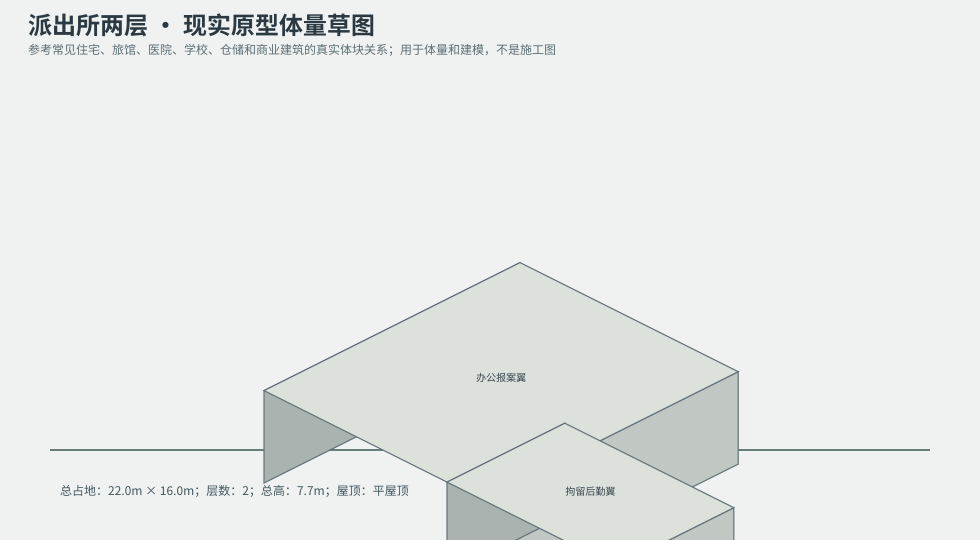
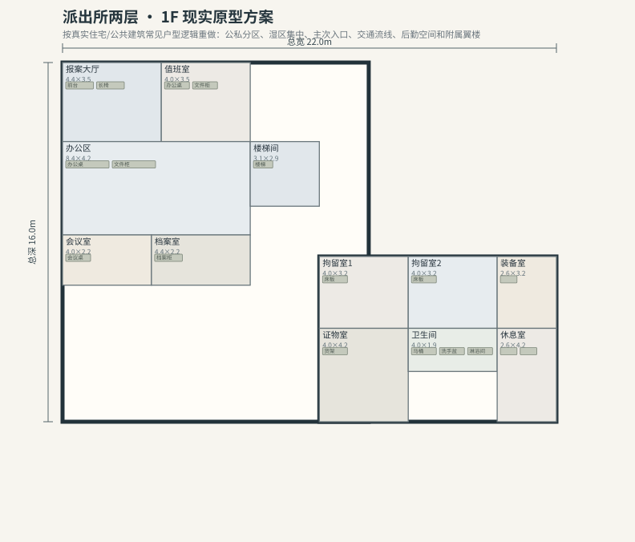
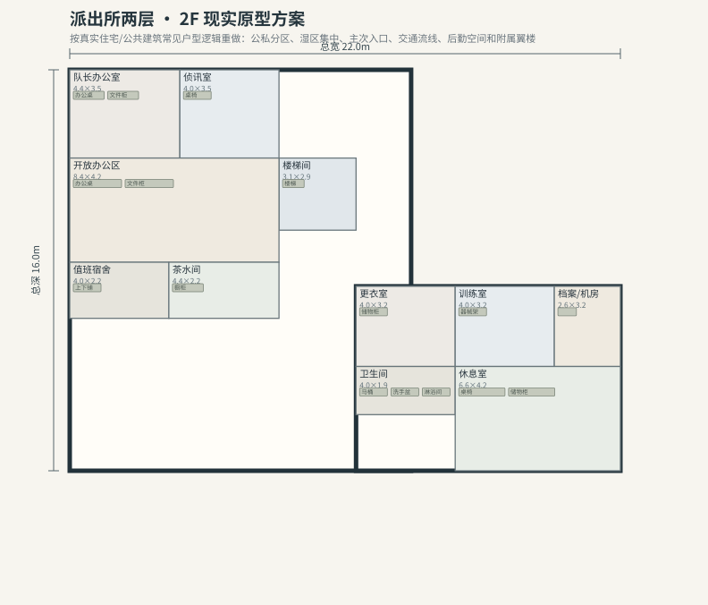

# BLD_017 · 派出所两层 — 现实原型重制说明

## 重制目标
本建筑按真实世界常见建筑原型重做，强调：体量变化、主次入口、公私分区、湿区集中、楼梯/电梯核、后勤空间、车库或设备翼、以及更合理的家具和动线。

## 基本参数
- 使用性质：公共
- 占地：22.0m × 16.0m
- 层数：2
- 总高：7.7m
- 屋顶：平屋顶
- 外立面：灰砖/钢结构

## 分层布局

### 1F

| 空间 | 尺寸（米） | 家具/设施 | 现实依据与功能 |
|---|---|---|---|
| 报案大厅 | 4.4 × 3.5 | 前台、长椅 | 交通空间 |
| 值班室 | 4.0 × 3.5 | 办公桌、文件柜 | 按真实房型功能组织 |
| 办公区 | 8.4 × 4.2 | 办公桌、文件柜 | 按真实房型功能组织 |
| 会议室 | 4.0 × 2.2 | 会议桌 | 按真实房型功能组织 |
| 档案室 | 4.4 × 2.2 | 档案柜 | 按真实房型功能组织 |
| 楼梯间 | 3.1 × 2.9 | 楼梯 | 交通空间 |
| 拘留室1 | 4.0 × 3.2 | 床板 | 按真实房型功能组织 |
| 拘留室2 | 4.0 × 3.2 | 床板 | 按真实房型功能组织 |
| 装备室 | 2.6 × 3.2 | 武器架 | 按真实房型功能组织 |
| 证物室 | 4.0 × 4.2 | 货架 | 按真实房型功能组织 |
| 卫生间 | 4.0 × 1.9 | 马桶、洗手盆、淋浴间 | 湿区集中 |
| 休息室 | 2.6 × 4.2 | 桌椅、储物柜 | 按真实房型功能组织 |

### 2F

| 空间 | 尺寸（米） | 家具/设施 | 现实依据与功能 |
|---|---|---|---|
| 楼梯间 | 3.1 × 2.9 | 楼梯 | 交通空间 |
| 队长办公室 | 4.4 × 3.5 | 办公桌、文件柜 | 按真实房型功能组织 |
| 侦讯室 | 4.0 × 3.5 | 桌椅 | 按真实房型功能组织 |
| 开放办公区 | 8.4 × 4.2 | 办公桌、文件柜 | 按真实房型功能组织 |
| 值班宿舍 | 4.0 × 2.2 | 上下铺 | 按真实房型功能组织 |
| 茶水间 | 4.4 × 2.2 | 橱柜 | 按真实房型功能组织 |
| 更衣室 | 4.0 × 3.2 | 储物柜 | 按真实房型功能组织 |
| 训练室 | 4.0 × 3.2 | 器械架 | 按真实房型功能组织 |
| 档案/机房 | 2.6 × 3.2 | 机柜 | 按真实房型功能组织 |
| 卫生间 | 4.0 × 1.9 | 马桶、洗手盆、淋浴间 | 湿区集中 |
| 休息室 | 6.6 × 4.2 | 桌椅、储物柜 | 按真实房型功能组织 |

## 游戏实现建议
- 用门、窗、楼梯、电梯核和家具碰撞去驱动导航，而不是只看外轮廓。
- 体量图中的不同翼楼、附属房和门廊建议建成独立美术模块，便于LOD和损坏替换。
- 房间容器建议按用途绑定掉落池，如厨房、药房、后仓、设备间、宿舍、档案室等。
- 真实导向不等于过度复杂；仍需为AI寻路、玩家识别和性能服务。
