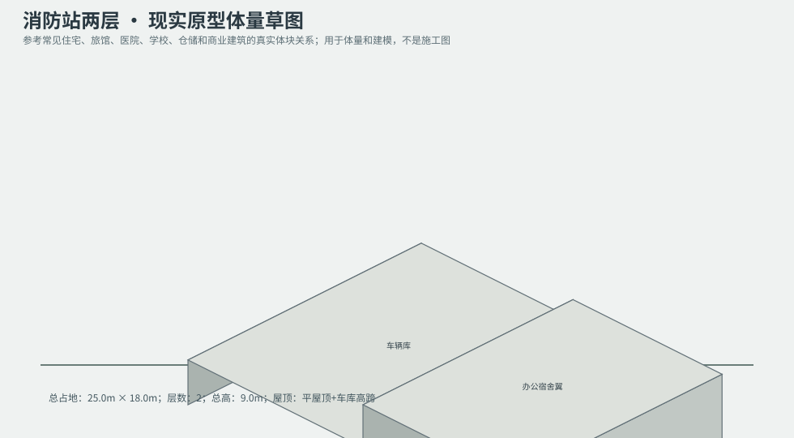
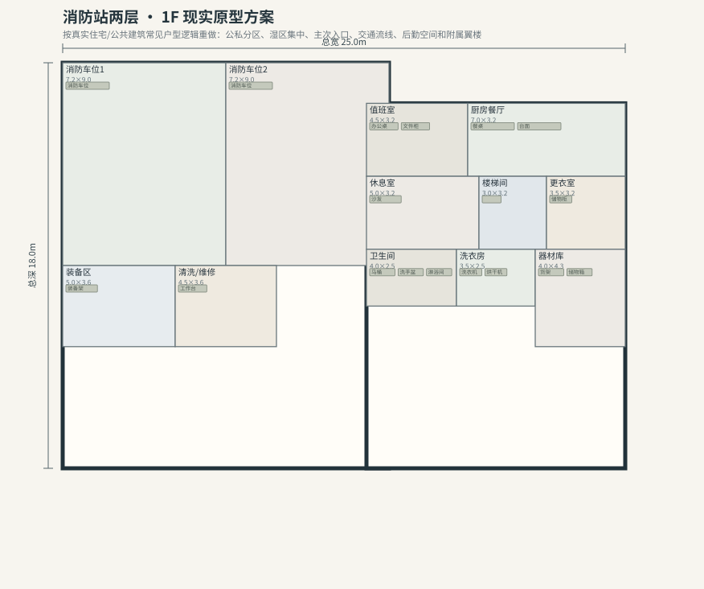
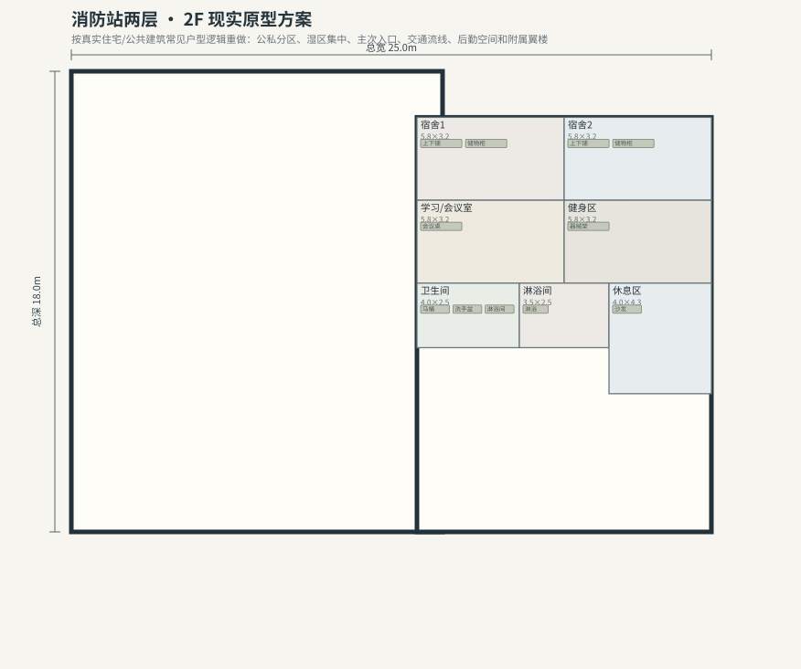

# BLD_018 · 消防站两层 — 现实原型重制说明

## 重制目标
本建筑按真实世界常见建筑原型重做，强调：体量变化、主次入口、公私分区、湿区集中、楼梯/电梯核、后勤空间、车库或设备翼、以及更合理的家具和动线。

## 基本参数
- 使用性质：公共
- 占地：25.0m × 18.0m
- 层数：2
- 总高：9.0m
- 屋顶：平屋顶+车库高跨
- 外立面：红砖/压型板

## 分层布局

### 1F

| 空间 | 尺寸（米） | 家具/设施 | 现实依据与功能 |
|---|---|---|---|
| 消防车位1 | 7.2 × 9.0 | 消防车位 | 按真实房型功能组织 |
| 消防车位2 | 7.2 × 9.0 | 消防车位 | 按真实房型功能组织 |
| 装备区 | 5.0 × 3.6 | 装备架 | 按真实房型功能组织 |
| 清洗/维修 | 4.5 × 3.6 | 工作台 | 按真实房型功能组织 |
| 值班室 | 4.5 × 3.2 | 办公桌、文件柜 | 按真实房型功能组织 |
| 厨房餐厅 | 7.0 × 3.2 | 餐桌、台面 | 湿区集中 |
| 休息室 | 5.0 × 3.2 | 沙发 | 按真实房型功能组织 |
| 楼梯间 | 3.0 × 3.2 | 楼梯 | 交通空间 |
| 更衣室 | 3.5 × 3.2 | 储物柜 | 按真实房型功能组织 |
| 卫生间 | 4.0 × 2.5 | 马桶、洗手盆、淋浴间 | 湿区集中 |
| 洗衣房 | 3.5 × 2.5 | 洗衣机、烘干机 | 湿区集中 |
| 器材库 | 4.0 × 4.3 | 货架、储物箱 | 按真实房型功能组织 |

### 2F

| 空间 | 尺寸（米） | 家具/设施 | 现实依据与功能 |
|---|---|---|---|
| 楼梯厅 | 3.0 × 3.2 | 楼梯 | 交通空间 |
| 宿舍1 | 5.8 × 3.2 | 上下铺、储物柜 | 按真实房型功能组织 |
| 宿舍2 | 5.8 × 3.2 | 上下铺、储物柜 | 按真实房型功能组织 |
| 学习/会议室 | 5.8 × 3.2 | 会议桌 | 按真实房型功能组织 |
| 健身区 | 5.8 × 3.2 | 器械架 | 按真实房型功能组织 |
| 卫生间 | 4.0 × 2.5 | 马桶、洗手盆、淋浴间 | 湿区集中 |
| 淋浴间 | 3.5 × 2.5 | 淋浴 | 按真实房型功能组织 |
| 休息区 | 4.0 × 4.3 | 沙发 | 按真实房型功能组织 |

## 游戏实现建议
- 用门、窗、楼梯、电梯核和家具碰撞去驱动导航，而不是只看外轮廓。
- 体量图中的不同翼楼、附属房和门廊建议建成独立美术模块，便于LOD和损坏替换。
- 房间容器建议按用途绑定掉落池，如厨房、药房、后仓、设备间、宿舍、档案室等。
- 真实导向不等于过度复杂；仍需为AI寻路、玩家识别和性能服务。
