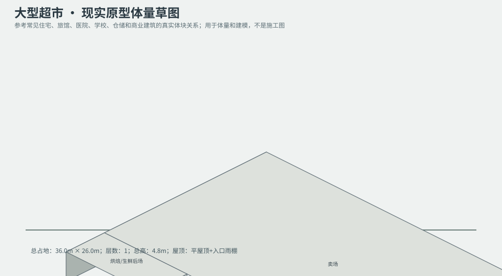
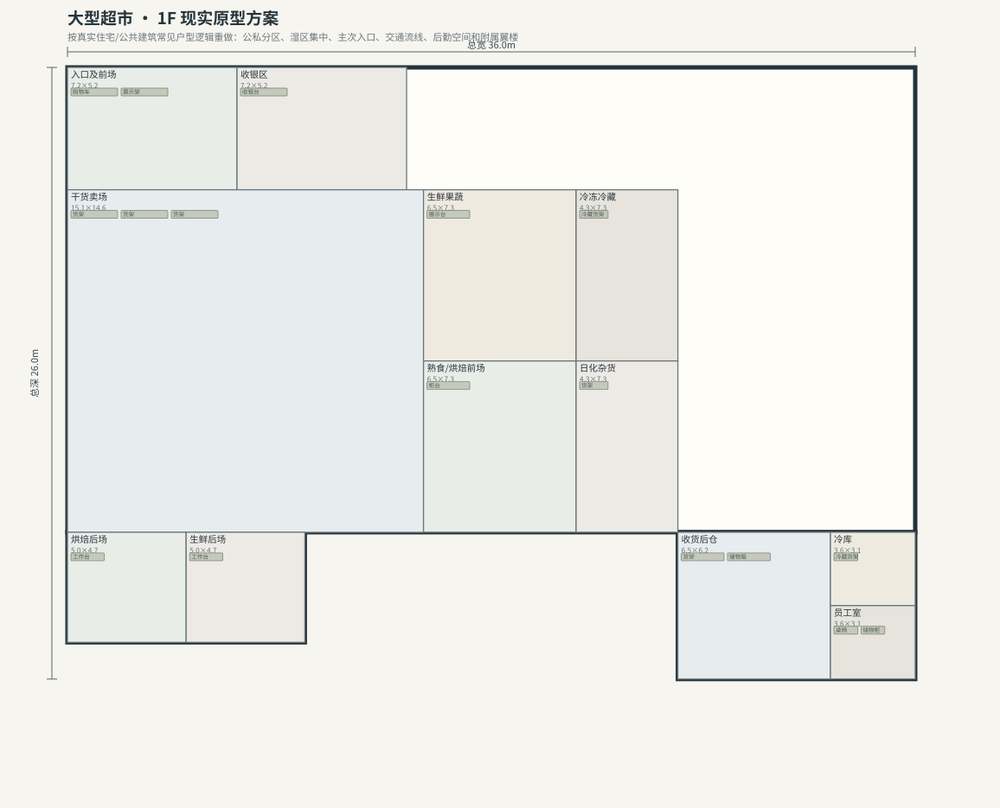

# BLD_020 · 大型超市 — 现实原型重制说明

## 重制目标
本建筑按真实世界常见建筑原型重做，强调：体量变化、主次入口、公私分区、湿区集中、楼梯/电梯核、后勤空间、车库或设备翼、以及更合理的家具和动线。

## 基本参数
- 使用性质：商业
- 占地：36.0m × 26.0m
- 层数：1
- 总高：4.8m
- 屋顶：平屋顶+入口雨棚
- 外立面：金属/玻璃

## 分层布局

### 1F

| 空间 | 尺寸（米） | 家具/设施 | 现实依据与功能 |
|---|---|---|---|
| 入口及前场 | 7.2 × 5.2 | 购物车、展示架 | 按真实房型功能组织 |
| 收银区 | 7.2 × 5.2 | 收银台 | 按真实房型功能组织 |
| 干货卖场 | 15.1 × 14.6 | 货架、货架、货架 | 按真实房型功能组织 |
| 生鲜果蔬 | 6.5 × 7.3 | 展示台 | 按真实房型功能组织 |
| 冷冻冷藏 | 4.3 × 7.3 | 冷藏货架 | 按真实房型功能组织 |
| 熟食/烘焙前场 | 6.5 × 7.3 | 柜台 | 按真实房型功能组织 |
| 日化杂货 | 4.3 × 7.3 | 货架 | 按真实房型功能组织 |
| 收货后仓 | 6.5 × 6.2 | 货架、储物箱 | 按真实房型功能组织 |
| 冷库 | 3.6 × 3.1 | 冷藏货架 | 按真实房型功能组织 |
| 员工室 | 3.6 × 3.1 | 桌椅、储物柜 | 按真实房型功能组织 |
| 烘焙后场 | 5.0 × 4.7 | 工作台 | 按真实房型功能组织 |
| 生鲜后场 | 5.0 × 4.7 | 工作台 | 按真实房型功能组织 |

## 游戏实现建议
- 用门、窗、楼梯、电梯核和家具碰撞去驱动导航，而不是只看外轮廓。
- 体量图中的不同翼楼、附属房和门廊建议建成独立美术模块，便于LOD和损坏替换。
- 房间容器建议按用途绑定掉落池，如厨房、药房、后仓、设备间、宿舍、档案室等。
- 真实导向不等于过度复杂；仍需为AI寻路、玩家识别和性能服务。
