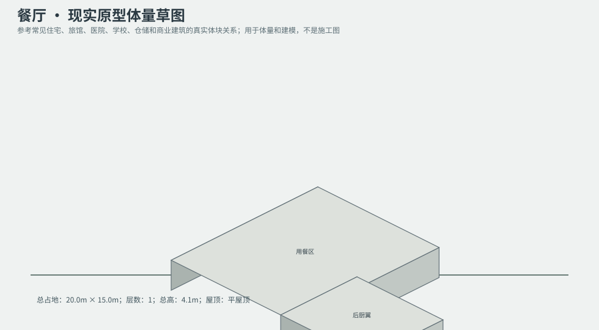
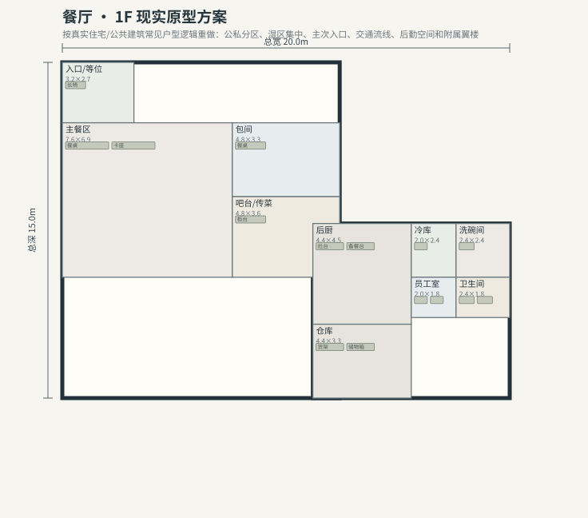

# BLD_022 · 餐厅 — 现实原型重制说明

## 重制目标
本建筑按真实世界常见建筑原型重做，强调：体量变化、主次入口、公私分区、湿区集中、楼梯/电梯核、后勤空间、车库或设备翼、以及更合理的家具和动线。

## 基本参数
- 使用性质：商业
- 占地：20.0m × 15.0m
- 层数：1
- 总高：4.1m
- 屋顶：平屋顶
- 外立面：砖/玻璃

## 分层布局

### 1F

| 空间 | 尺寸（米） | 家具/设施 | 现实依据与功能 |
|---|---|---|---|
| 入口/等位 | 3.2 × 2.7 | 长椅 | 按真实房型功能组织 |
| 主餐区 | 7.6 × 6.9 | 餐桌、卡座 | 按真实房型功能组织 |
| 包间 | 4.8 × 3.3 | 餐桌 | 按真实房型功能组织 |
| 吧台/传菜 | 4.8 × 3.6 | 柜台 | 按真实房型功能组织 |
| 后厨 | 4.4 × 4.5 | 灶台、备餐台 | 按真实房型功能组织 |
| 冷库 | 2.0 × 2.4 | 冷藏货架 | 按真实房型功能组织 |
| 洗碗间 | 2.4 × 2.4 | 水池 | 按真实房型功能组织 |
| 员工室 | 2.0 × 1.8 | 桌椅、储物柜 | 按真实房型功能组织 |
| 卫生间 | 2.4 × 1.8 | 马桶、洗手盆、淋浴间 | 湿区集中 |
| 仓库 | 4.4 × 3.3 | 货架、储物箱 | 按真实房型功能组织 |

## 游戏实现建议
- 用门、窗、楼梯、电梯核和家具碰撞去驱动导航，而不是只看外轮廓。
- 体量图中的不同翼楼、附属房和门廊建议建成独立美术模块，便于LOD和损坏替换。
- 房间容器建议按用途绑定掉落池，如厨房、药房、后仓、设备间、宿舍、档案室等。
- 真实导向不等于过度复杂；仍需为AI寻路、玩家识别和性能服务。
