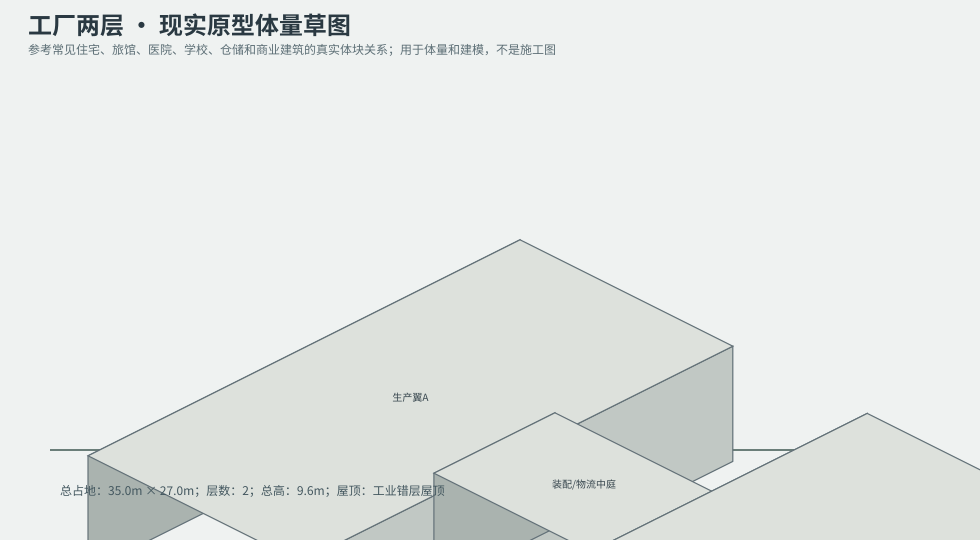
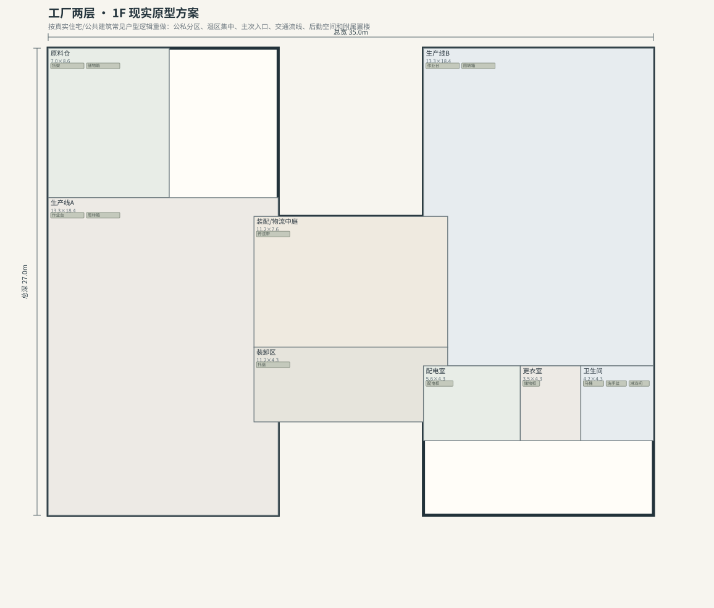
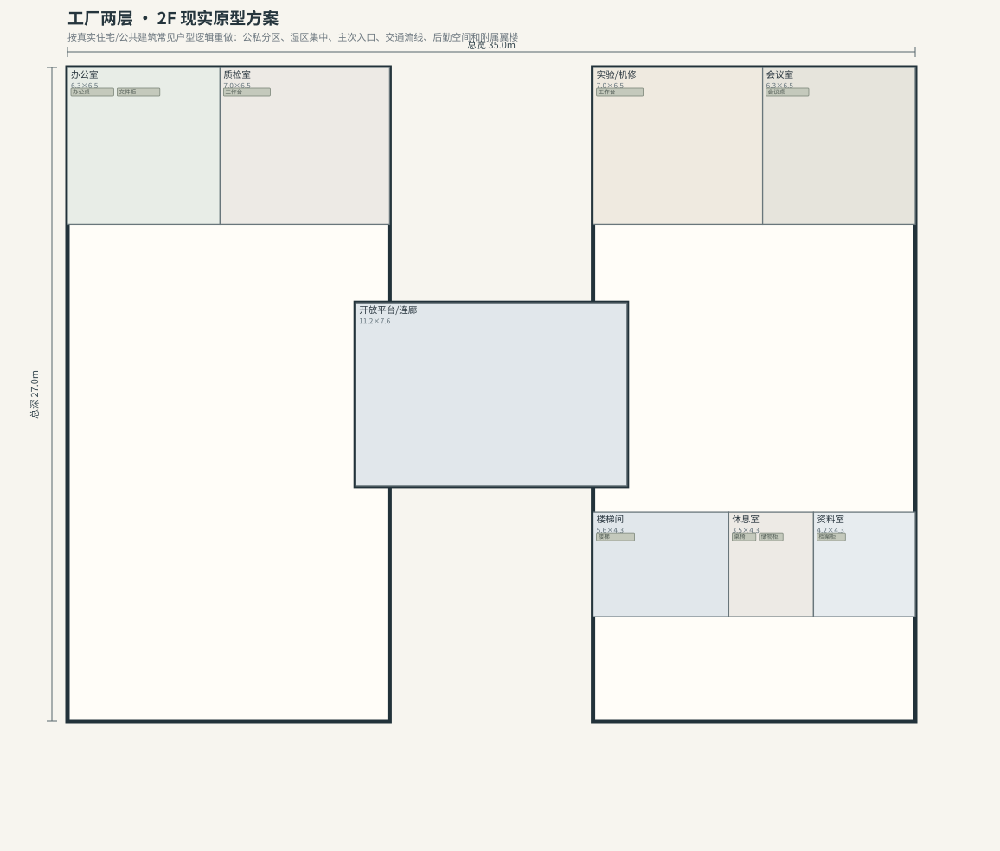

# BLD_028 · 工厂两层 — 现实原型重制说明

## 重制目标
本建筑按真实世界常见建筑原型重做，强调：体量变化、主次入口、公私分区、湿区集中、楼梯/电梯核、后勤空间、车库或设备翼、以及更合理的家具和动线。

## 基本参数
- 使用性质：工业
- 占地：35.0m × 27.0m
- 层数：2
- 总高：9.6m
- 屋顶：工业错层屋顶
- 外立面：混凝土/金属板

## 分层布局

### 1F

| 空间 | 尺寸（米） | 家具/设施 | 现实依据与功能 |
|---|---|---|---|
| 原料仓 | 7.0 × 8.6 | 货架、储物箱 | 按真实房型功能组织 |
| 生产线A | 13.3 × 18.4 | 作业台、周转箱 | 按真实房型功能组织 |
| 生产线B | 13.3 × 18.4 | 作业台、周转箱 | 按真实房型功能组织 |
| 装配/物流中庭 | 11.2 × 7.6 | 传送带 | 按真实房型功能组织 |
| 装卸区 | 11.2 × 4.3 | 托盘 | 按真实房型功能组织 |
| 配电室 | 5.6 × 4.3 | 配电柜 | 按真实房型功能组织 |
| 更衣室 | 3.5 × 4.3 | 储物柜 | 按真实房型功能组织 |
| 卫生间 | 4.2 × 4.3 | 马桶、洗手盆、淋浴间 | 湿区集中 |

### 2F

| 空间 | 尺寸（米） | 家具/设施 | 现实依据与功能 |
|---|---|---|---|
| 办公室 | 6.3 × 6.5 | 办公桌、文件柜 | 按真实房型功能组织 |
| 质检室 | 7.0 × 6.5 | 工作台 | 按真实房型功能组织 |
| 开放平台/连廊 | 11.2 × 7.6 | 无 | 交通空间 |
| 实验/机修 | 7.0 × 6.5 | 工作台 | 按真实房型功能组织 |
| 会议室 | 6.3 × 6.5 | 会议桌 | 按真实房型功能组织 |
| 楼梯间 | 5.6 × 4.3 | 楼梯 | 交通空间 |
| 休息室 | 3.5 × 4.3 | 桌椅、储物柜 | 按真实房型功能组织 |
| 资料室 | 4.2 × 4.3 | 档案柜 | 按真实房型功能组织 |

## 游戏实现建议
- 用门、窗、楼梯、电梯核和家具碰撞去驱动导航，而不是只看外轮廓。
- 体量图中的不同翼楼、附属房和门廊建议建成独立美术模块，便于LOD和损坏替换。
- 房间容器建议按用途绑定掉落池，如厨房、药房、后仓、设备间、宿舍、档案室等。
- 真实导向不等于过度复杂；仍需为AI寻路、玩家识别和性能服务。
