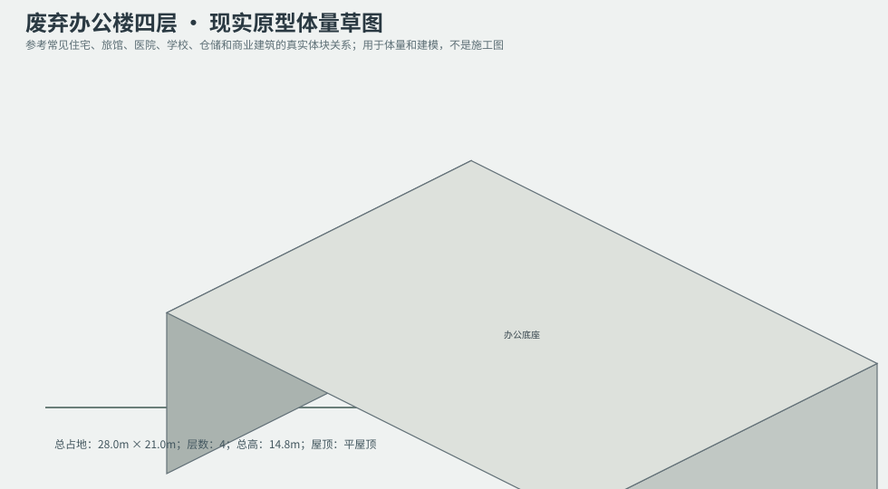
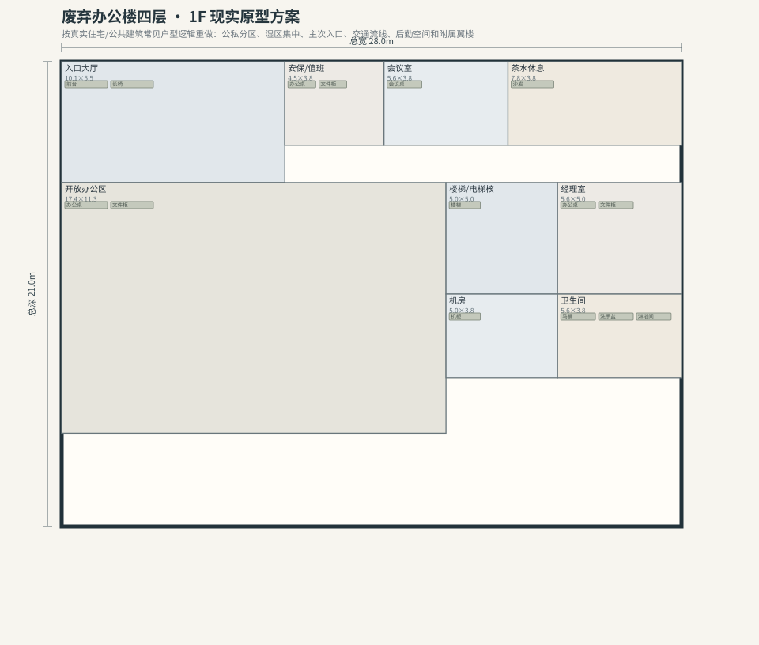
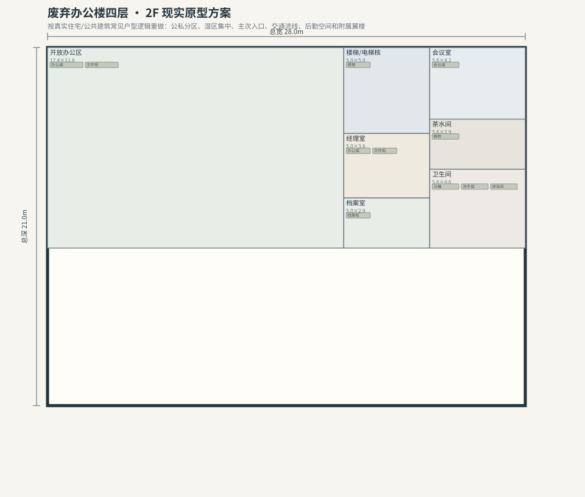
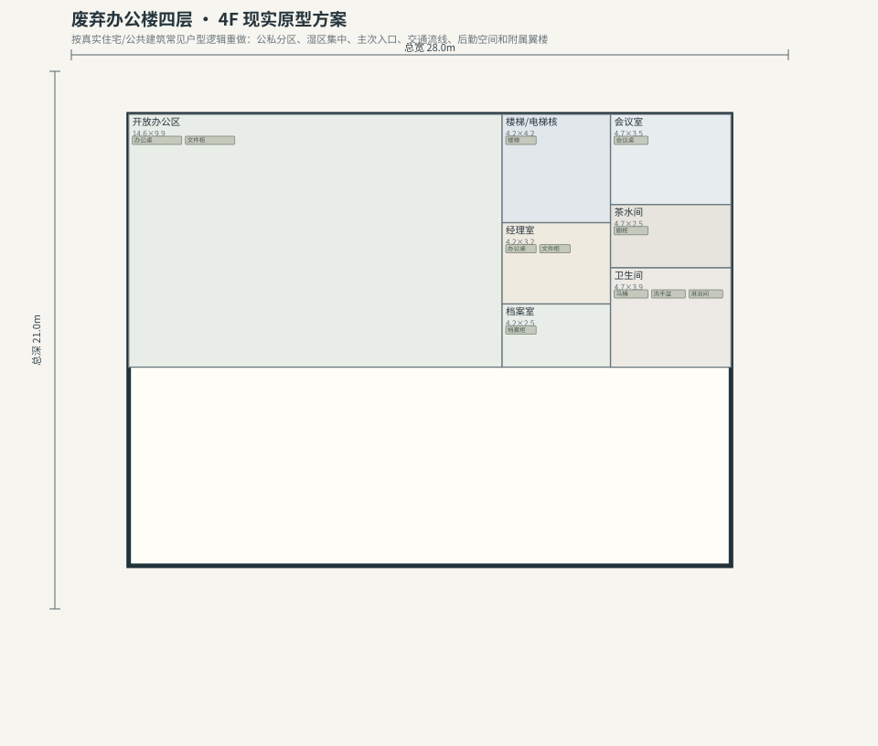

# BLD_030 · 废弃办公楼四层 — 现实原型重制说明

## 重制目标
本建筑按真实世界常见建筑原型重做，强调：体量变化、主次入口、公私分区、湿区集中、楼梯/电梯核、后勤空间、车库或设备翼、以及更合理的家具和动线。

## 基本参数
- 使用性质：办公
- 占地：28.0m × 21.0m
- 层数：4
- 总高：14.8m
- 屋顶：平屋顶
- 外立面：砖/玻璃幕墙

## 分层布局

### 1F

| 空间 | 尺寸（米） | 家具/设施 | 现实依据与功能 |
|---|---|---|---|
| 入口大厅 | 10.1 × 5.5 | 前台、长椅 | 交通空间 |
| 安保/值班 | 4.5 × 3.8 | 办公桌、文件柜 | 按真实房型功能组织 |
| 会议室 | 5.6 × 3.8 | 会议桌 | 按真实房型功能组织 |
| 茶水休息 | 7.8 × 3.8 | 沙发 | 按真实房型功能组织 |
| 开放办公区 | 17.4 × 11.3 | 办公桌、文件柜 | 按真实房型功能组织 |
| 楼梯/电梯核 | 5.0 × 5.0 | 楼梯 | 交通空间 |
| 经理室 | 5.6 × 5.0 | 办公桌、文件柜 | 按真实房型功能组织 |
| 机房 | 5.0 × 3.8 | 机柜 | 按真实房型功能组织 |
| 卫生间 | 5.6 × 3.8 | 马桶、洗手盆、淋浴间 | 湿区集中 |

### 2F

| 空间 | 尺寸（米） | 家具/设施 | 现实依据与功能 |
|---|---|---|---|
| 开放办公区 | 17.4 × 11.8 | 办公桌、文件柜 | 按真实房型功能组织 |
| 楼梯/电梯核 | 5.0 × 5.0 | 楼梯 | 交通空间 |
| 会议室 | 5.6 × 4.2 | 会议桌 | 按真实房型功能组织 |
| 经理室 | 5.0 × 3.8 | 办公桌、文件柜 | 按真实房型功能组织 |
| 茶水间 | 5.6 × 2.9 | 橱柜 | 按真实房型功能组织 |
| 档案室 | 5.0 × 2.9 | 档案柜 | 按真实房型功能组织 |
| 卫生间 | 5.6 × 4.6 | 马桶、洗手盆、淋浴间 | 湿区集中 |

### 3F

| 空间 | 尺寸（米） | 家具/设施 | 现实依据与功能 |
|---|---|---|---|
| 开放办公区 | 14.6 × 9.9 | 办公桌、文件柜 | 按真实房型功能组织 |
| 楼梯/电梯核 | 4.2 × 4.2 | 楼梯 | 交通空间 |
| 会议室 | 4.7 × 3.5 | 会议桌 | 按真实房型功能组织 |
| 经理室 | 4.2 × 3.2 | 办公桌、文件柜 | 按真实房型功能组织 |
| 茶水间 | 4.7 × 2.5 | 橱柜 | 按真实房型功能组织 |
| 档案室 | 4.2 × 2.5 | 档案柜 | 按真实房型功能组织 |
| 卫生间 | 4.7 × 3.9 | 马桶、洗手盆、淋浴间 | 湿区集中 |

### 4F

| 空间 | 尺寸（米） | 家具/设施 | 现实依据与功能 |
|---|---|---|---|
| 开放办公区 | 14.6 × 9.9 | 办公桌、文件柜 | 按真实房型功能组织 |
| 楼梯/电梯核 | 4.2 × 4.2 | 楼梯 | 交通空间 |
| 会议室 | 4.7 × 3.5 | 会议桌 | 按真实房型功能组织 |
| 经理室 | 4.2 × 3.2 | 办公桌、文件柜 | 按真实房型功能组织 |
| 茶水间 | 4.7 × 2.5 | 橱柜 | 按真实房型功能组织 |
| 档案室 | 4.2 × 2.5 | 档案柜 | 按真实房型功能组织 |
| 卫生间 | 4.7 × 3.9 | 马桶、洗手盆、淋浴间 | 湿区集中 |

## 游戏实现建议
- 用门、窗、楼梯、电梯核和家具碰撞去驱动导航，而不是只看外轮廓。
- 体量图中的不同翼楼、附属房和门廊建议建成独立美术模块，便于LOD和损坏替换。
- 房间容器建议按用途绑定掉落池，如厨房、药房、后仓、设备间、宿舍、档案室等。
- 真实导向不等于过度复杂；仍需为AI寻路、玩家识别和性能服务。
