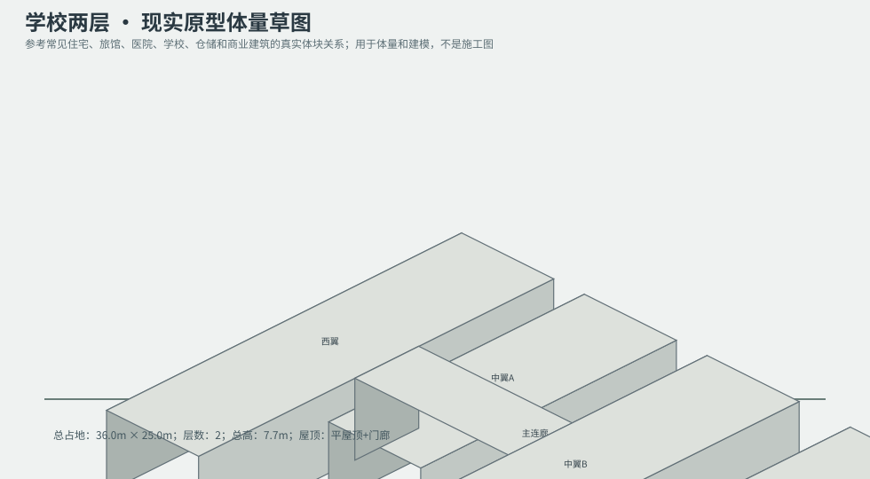
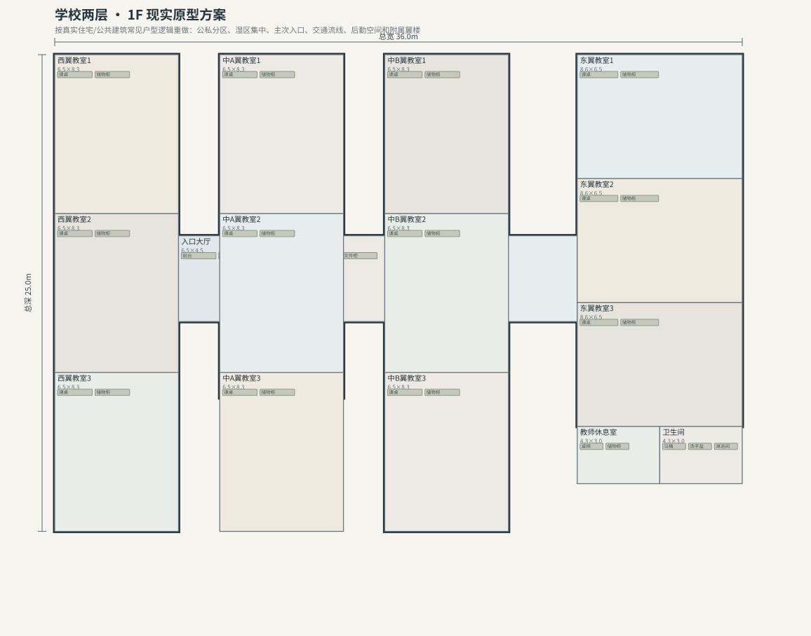
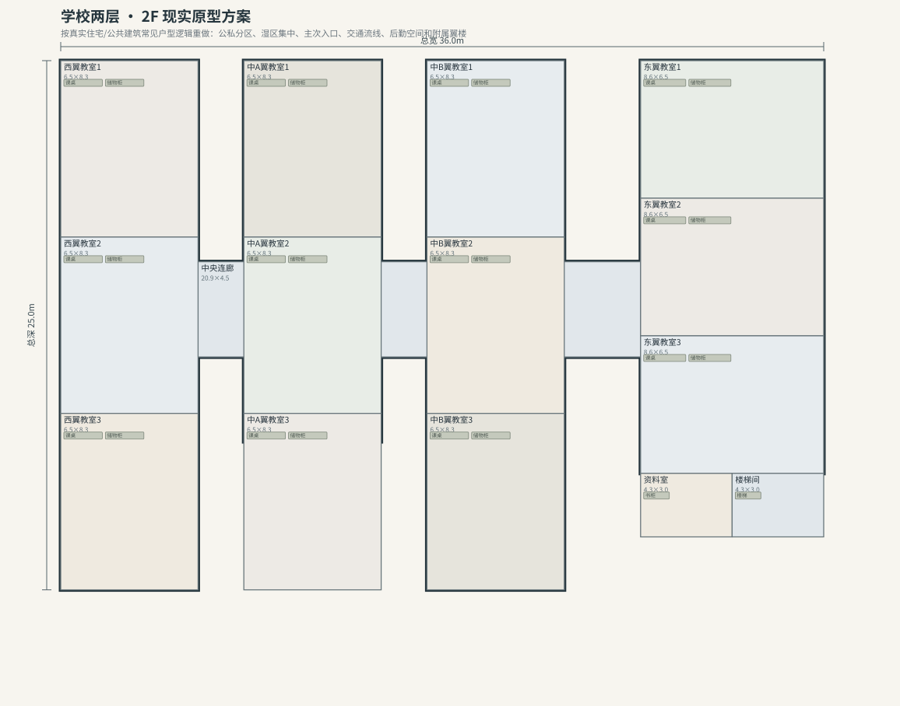

# BLD_031 · 学校两层 — 现实原型重制说明

## 重制目标
本建筑按真实世界常见建筑原型重做，强调：体量变化、主次入口、公私分区、湿区集中、楼梯/电梯核、后勤空间、车库或设备翼、以及更合理的家具和动线。

## 基本参数
- 使用性质：公共
- 占地：36.0m × 25.0m
- 层数：2
- 总高：7.7m
- 屋顶：平屋顶+门廊
- 外立面：红砖/深灰窗框

## 分层布局

### 1F

| 空间 | 尺寸（米） | 家具/设施 | 现实依据与功能 |
|---|---|---|---|
| 入口大厅 | 6.5 × 4.5 | 前台、长椅 | 交通空间 |
| 行政办公室 | 6.5 × 4.5 | 办公桌、文件柜 | 按真实房型功能组织 |
| 医务/广播室 | 7.9 × 4.5 | 检查床、柜体 | 按真实房型功能组织 |
| 西翼教室1 | 6.5 × 8.3 | 课桌、储物柜 | 按真实房型功能组织 |
| 西翼教室2 | 6.5 × 8.3 | 课桌、储物柜 | 按真实房型功能组织 |
| 西翼教室3 | 6.5 × 8.3 | 课桌、储物柜 | 按真实房型功能组织 |
| 中A翼教室1 | 6.5 × 8.3 | 课桌、储物柜 | 按真实房型功能组织 |
| 中A翼教室2 | 6.5 × 8.3 | 课桌、储物柜 | 按真实房型功能组织 |
| 中A翼教室3 | 6.5 × 8.3 | 课桌、储物柜 | 按真实房型功能组织 |
| 中B翼教室1 | 6.5 × 8.3 | 课桌、储物柜 | 按真实房型功能组织 |
| 中B翼教室2 | 6.5 × 8.3 | 课桌、储物柜 | 按真实房型功能组织 |
| 中B翼教室3 | 6.5 × 8.3 | 课桌、储物柜 | 按真实房型功能组织 |
| 东翼教室1 | 8.6 × 6.5 | 课桌、储物柜 | 按真实房型功能组织 |
| 东翼教室2 | 8.6 × 6.5 | 课桌、储物柜 | 按真实房型功能组织 |
| 东翼教室3 | 8.6 × 6.5 | 课桌、储物柜 | 按真实房型功能组织 |
| 教师休息室 | 4.3 × 3.0 | 桌椅、储物柜 | 按真实房型功能组织 |
| 卫生间 | 4.3 × 3.0 | 马桶、洗手盆、淋浴间 | 湿区集中 |

### 2F

| 空间 | 尺寸（米） | 家具/设施 | 现实依据与功能 |
|---|---|---|---|
| 中央连廊 | 20.9 × 4.5 | 无 | 交通空间 |
| 西翼教室1 | 6.5 × 8.3 | 课桌、储物柜 | 按真实房型功能组织 |
| 西翼教室2 | 6.5 × 8.3 | 课桌、储物柜 | 按真实房型功能组织 |
| 西翼教室3 | 6.5 × 8.3 | 课桌、储物柜 | 按真实房型功能组织 |
| 中A翼教室1 | 6.5 × 8.3 | 课桌、储物柜 | 按真实房型功能组织 |
| 中A翼教室2 | 6.5 × 8.3 | 课桌、储物柜 | 按真实房型功能组织 |
| 中A翼教室3 | 6.5 × 8.3 | 课桌、储物柜 | 按真实房型功能组织 |
| 中B翼教室1 | 6.5 × 8.3 | 课桌、储物柜 | 按真实房型功能组织 |
| 中B翼教室2 | 6.5 × 8.3 | 课桌、储物柜 | 按真实房型功能组织 |
| 中B翼教室3 | 6.5 × 8.3 | 课桌、储物柜 | 按真实房型功能组织 |
| 东翼教室1 | 8.6 × 6.5 | 课桌、储物柜 | 按真实房型功能组织 |
| 东翼教室2 | 8.6 × 6.5 | 课桌、储物柜 | 按真实房型功能组织 |
| 东翼教室3 | 8.6 × 6.5 | 课桌、储物柜 | 按真实房型功能组织 |
| 资料室 | 4.3 × 3.0 | 书柜 | 按真实房型功能组织 |
| 楼梯间 | 4.3 × 3.0 | 楼梯 | 交通空间 |

## 游戏实现建议
- 用门、窗、楼梯、电梯核和家具碰撞去驱动导航，而不是只看外轮廓。
- 体量图中的不同翼楼、附属房和门廊建议建成独立美术模块，便于LOD和损坏替换。
- 房间容器建议按用途绑定掉落池，如厨房、药房、后仓、设备间、宿舍、档案室等。
- 真实导向不等于过度复杂；仍需为AI寻路、玩家识别和性能服务。
