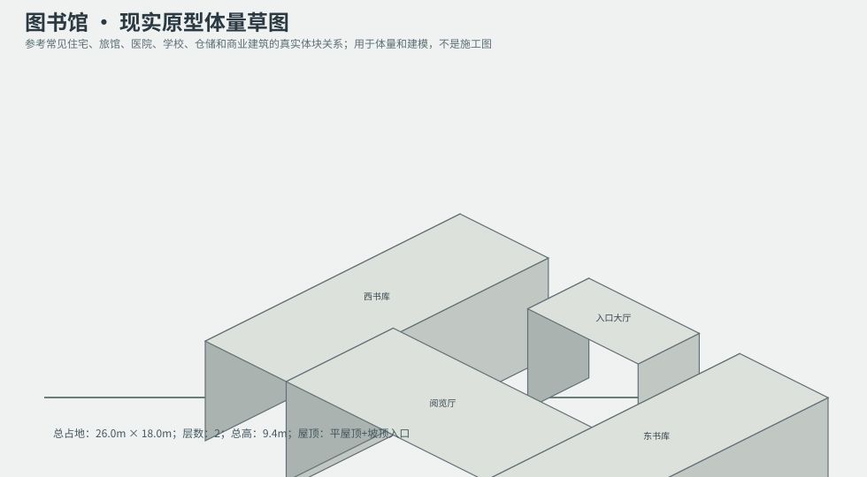
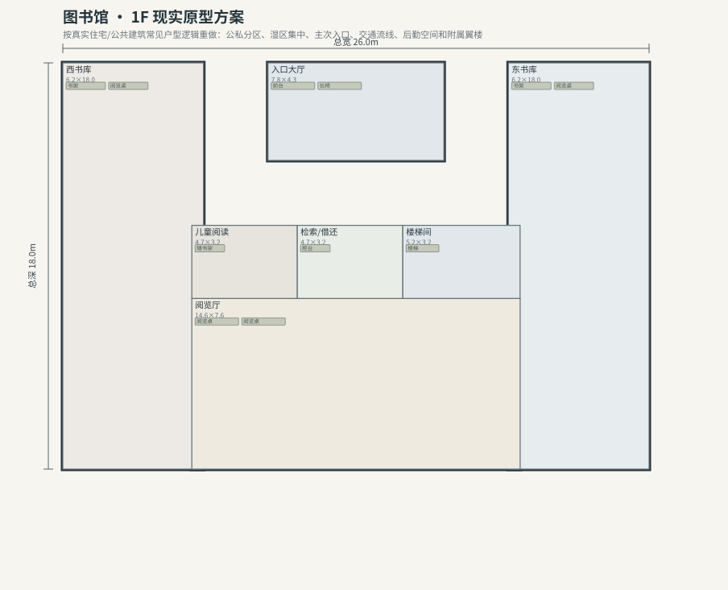
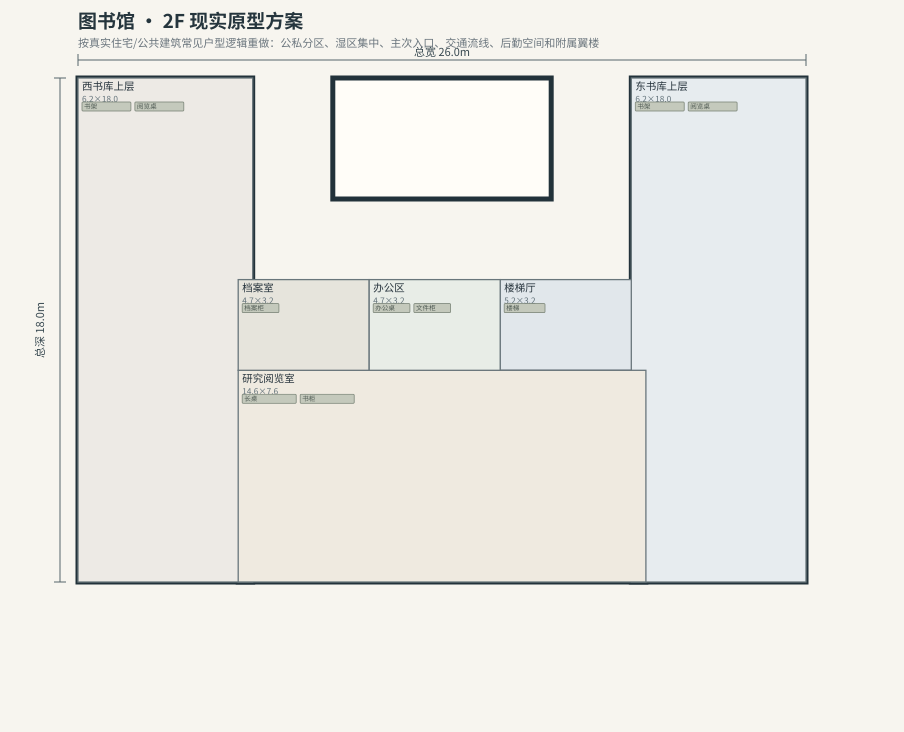

# BLD_033 · 图书馆 — 现实原型重制说明

## 重制目标
本建筑按真实世界常见建筑原型重做，强调：体量变化、主次入口、公私分区、湿区集中、楼梯/电梯核、后勤空间、车库或设备翼、以及更合理的家具和动线。

## 基本参数
- 使用性质：公共
- 占地：26.0m × 18.0m
- 层数：2
- 总高：9.4m
- 屋顶：平屋顶+坡顶入口
- 外立面：砖/玻璃

## 分层布局

### 1F

| 空间 | 尺寸（米） | 家具/设施 | 现实依据与功能 |
|---|---|---|---|
| 入口大厅 | 7.8 × 4.3 | 前台、长椅 | 交通空间 |
| 西书库 | 6.2 × 18.0 | 书架、阅览桌 | 按真实房型功能组织 |
| 东书库 | 6.2 × 18.0 | 书架、阅览桌 | 按真实房型功能组织 |
| 阅览厅 | 14.6 × 7.6 | 阅览桌、阅览桌 | 按真实房型功能组织 |
| 儿童阅读 | 4.7 × 3.2 | 矮书架 | 按真实房型功能组织 |
| 检索/借还 | 4.7 × 3.2 | 柜台 | 按真实房型功能组织 |
| 楼梯间 | 5.2 × 3.2 | 楼梯 | 交通空间 |

### 2F

| 空间 | 尺寸（米） | 家具/设施 | 现实依据与功能 |
|---|---|---|---|
| 楼梯厅 | 5.2 × 3.2 | 楼梯 | 交通空间 |
| 西书库上层 | 6.2 × 18.0 | 书架、阅览桌 | 按真实房型功能组织 |
| 东书库上层 | 6.2 × 18.0 | 书架、阅览桌 | 按真实房型功能组织 |
| 研究阅览室 | 14.6 × 7.6 | 长桌、书柜 | 按真实房型功能组织 |
| 档案室 | 4.7 × 3.2 | 档案柜 | 按真实房型功能组织 |
| 办公区 | 4.7 × 3.2 | 办公桌、文件柜 | 按真实房型功能组织 |

## 游戏实现建议
- 用门、窗、楼梯、电梯核和家具碰撞去驱动导航，而不是只看外轮廓。
- 体量图中的不同翼楼、附属房和门廊建议建成独立美术模块，便于LOD和损坏替换。
- 房间容器建议按用途绑定掉落池，如厨房、药房、后仓、设备间、宿舍、档案室等。
- 真实导向不等于过度复杂；仍需为AI寻路、玩家识别和性能服务。
