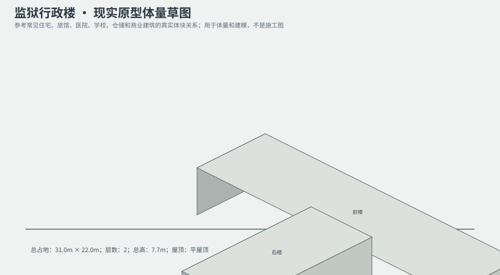
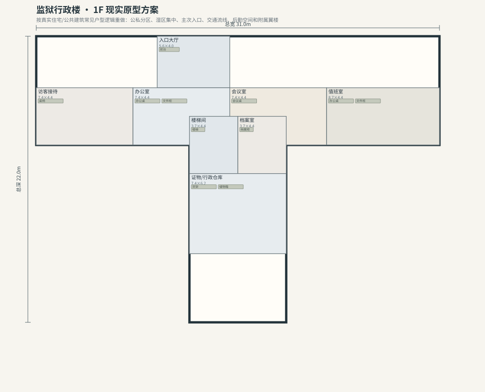
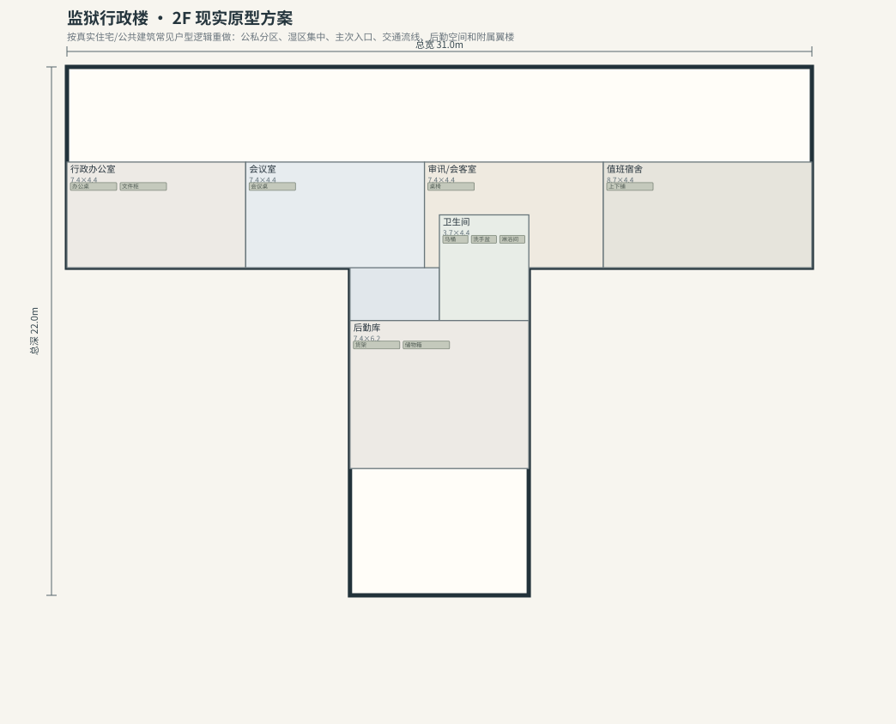

# BLD_034 · 监狱行政楼 — 现实原型重制说明

## 重制目标
本建筑按真实世界常见建筑原型重做，强调：体量变化、主次入口、公私分区、湿区集中、楼梯/电梯核、后勤空间、车库或设备翼、以及更合理的家具和动线。

## 基本参数
- 使用性质：公共
- 占地：31.0m × 22.0m
- 层数：2
- 总高：7.7m
- 屋顶：平屋顶
- 外立面：混凝土/深砖

## 分层布局

### 1F

| 空间 | 尺寸（米） | 家具/设施 | 现实依据与功能 |
|---|---|---|---|
| 入口大厅 | 5.6 × 4.0 | 前台 | 交通空间 |
| 访客接待 | 7.4 × 4.4 | 桌椅 | 按真实房型功能组织 |
| 办公室 | 7.4 × 4.4 | 办公桌、文件柜 | 按真实房型功能组织 |
| 会议室 | 7.4 × 4.4 | 会议桌 | 按真实房型功能组织 |
| 值班室 | 8.7 × 4.4 | 办公桌、文件柜 | 按真实房型功能组织 |
| 楼梯间 | 3.7 × 4.4 | 楼梯 | 交通空间 |
| 档案室 | 3.7 × 4.4 | 档案柜 | 按真实房型功能组织 |
| 证物/行政仓库 | 7.4 × 6.2 | 货架、储物箱 | 按真实房型功能组织 |

### 2F

| 空间 | 尺寸（米） | 家具/设施 | 现实依据与功能 |
|---|---|---|---|
| 楼梯厅 | 3.7 × 4.4 | 楼梯 | 交通空间 |
| 行政办公室 | 7.4 × 4.4 | 办公桌、文件柜 | 按真实房型功能组织 |
| 会议室 | 7.4 × 4.4 | 会议桌 | 按真实房型功能组织 |
| 审讯/会客室 | 7.4 × 4.4 | 桌椅 | 按真实房型功能组织 |
| 值班宿舍 | 8.7 × 4.4 | 上下铺 | 按真实房型功能组织 |
| 卫生间 | 3.7 × 4.4 | 马桶、洗手盆、淋浴间 | 湿区集中 |
| 后勤库 | 7.4 × 6.2 | 货架、储物箱 | 按真实房型功能组织 |

## 游戏实现建议
- 用门、窗、楼梯、电梯核和家具碰撞去驱动导航，而不是只看外轮廓。
- 体量图中的不同翼楼、附属房和门廊建议建成独立美术模块，便于LOD和损坏替换。
- 房间容器建议按用途绑定掉落池，如厨房、药房、后仓、设备间、宿舍、档案室等。
- 真实导向不等于过度复杂；仍需为AI寻路、玩家识别和性能服务。
