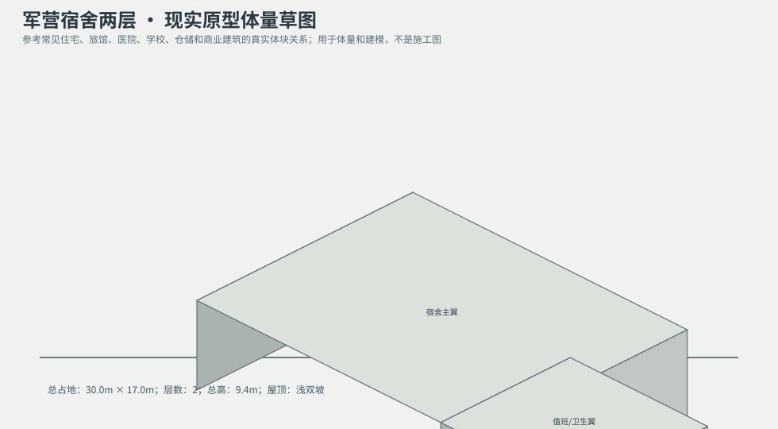
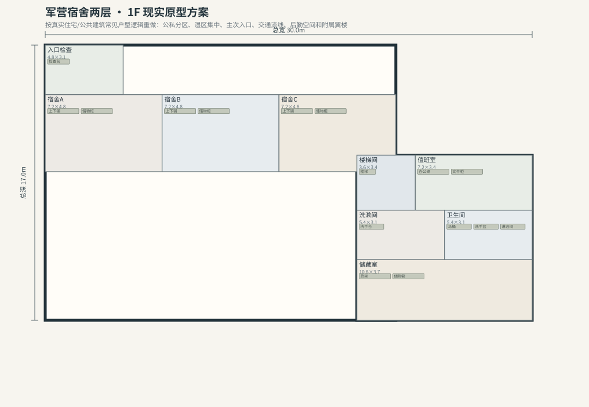
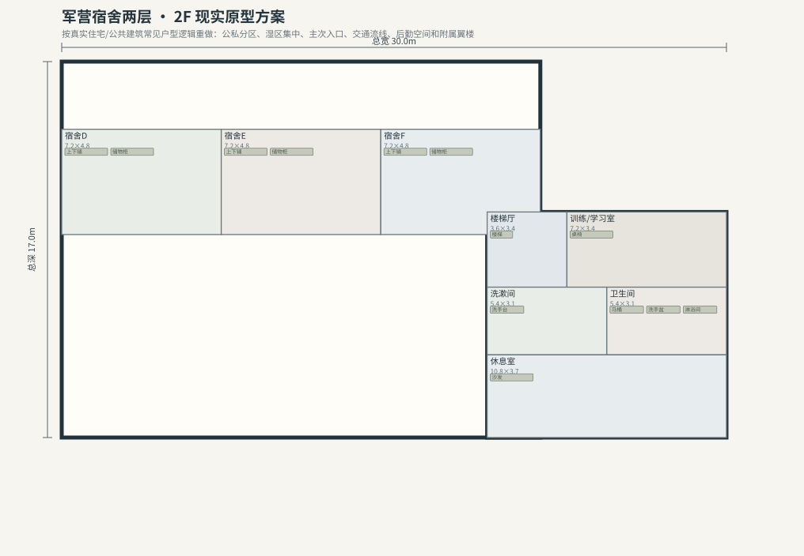

# BLD_035 · 军营宿舍两层 — 现实原型重制说明

## 重制目标
本建筑按真实世界常见建筑原型重做，强调：体量变化、主次入口、公私分区、湿区集中、楼梯/电梯核、后勤空间、车库或设备翼、以及更合理的家具和动线。

## 基本参数
- 使用性质：军事
- 占地：30.0m × 17.0m
- 层数：2
- 总高：9.4m
- 屋顶：浅双坡
- 外立面：混凝土/灰泥

## 分层布局

### 1F

| 空间 | 尺寸（米） | 家具/设施 | 现实依据与功能 |
|---|---|---|---|
| 入口检查 | 4.8 × 3.1 | 检查台 | 按真实房型功能组织 |
| 宿舍A | 7.2 × 4.8 | 上下铺、储物柜 | 按真实房型功能组织 |
| 宿舍B | 7.2 × 4.8 | 上下铺、储物柜 | 按真实房型功能组织 |
| 宿舍C | 7.2 × 4.8 | 上下铺、储物柜 | 按真实房型功能组织 |
| 楼梯间 | 3.6 × 3.4 | 楼梯 | 交通空间 |
| 值班室 | 7.2 × 3.4 | 办公桌、文件柜 | 按真实房型功能组织 |
| 洗漱间 | 5.4 × 3.1 | 洗手台 | 按真实房型功能组织 |
| 卫生间 | 5.4 × 3.1 | 马桶、洗手盆、淋浴间 | 湿区集中 |
| 储藏室 | 10.8 × 3.7 | 货架、储物箱 | 按真实房型功能组织 |

### 2F

| 空间 | 尺寸（米） | 家具/设施 | 现实依据与功能 |
|---|---|---|---|
| 宿舍D | 7.2 × 4.8 | 上下铺、储物柜 | 按真实房型功能组织 |
| 宿舍E | 7.2 × 4.8 | 上下铺、储物柜 | 按真实房型功能组织 |
| 宿舍F | 7.2 × 4.8 | 上下铺、储物柜 | 按真实房型功能组织 |
| 楼梯厅 | 3.6 × 3.4 | 楼梯 | 交通空间 |
| 训练/学习室 | 7.2 × 3.4 | 桌椅 | 按真实房型功能组织 |
| 洗漱间 | 5.4 × 3.1 | 洗手台 | 按真实房型功能组织 |
| 卫生间 | 5.4 × 3.1 | 马桶、洗手盆、淋浴间 | 湿区集中 |
| 休息室 | 10.8 × 3.7 | 沙发 | 按真实房型功能组织 |

## 游戏实现建议
- 用门、窗、楼梯、电梯核和家具碰撞去驱动导航，而不是只看外轮廓。
- 体量图中的不同翼楼、附属房和门廊建议建成独立美术模块，便于LOD和损坏替换。
- 房间容器建议按用途绑定掉落池，如厨房、药房、后仓、设备间、宿舍、档案室等。
- 真实导向不等于过度复杂；仍需为AI寻路、玩家识别和性能服务。
