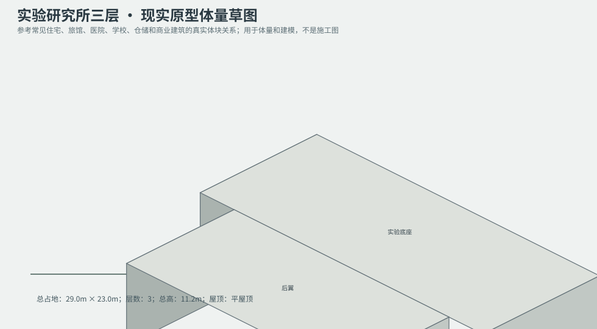
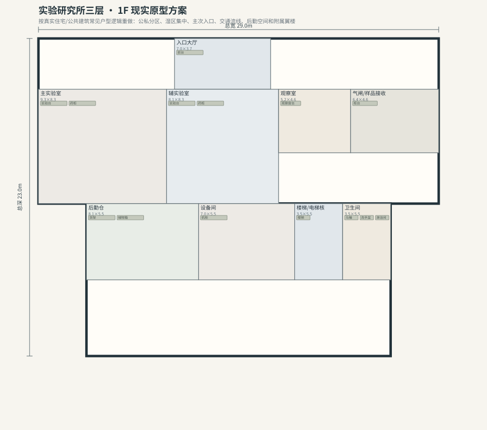
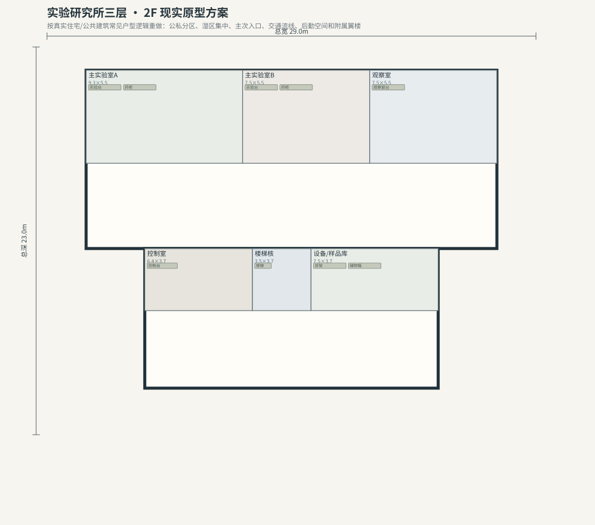
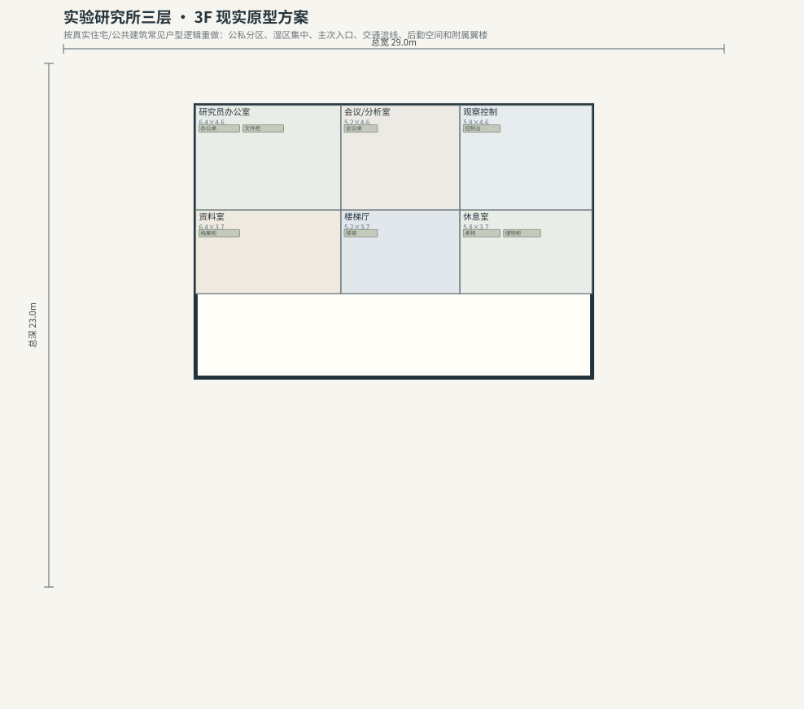

# BLD_037 · 实验研究所三层 — 现实原型重制说明

## 重制目标
本建筑按真实世界常见建筑原型重做，强调：体量变化、主次入口、公私分区、湿区集中、楼梯/电梯核、后勤空间、车库或设备翼、以及更合理的家具和动线。

## 基本参数
- 使用性质：特殊
- 占地：29.0m × 23.0m
- 层数：3
- 总高：11.2m
- 屋顶：平屋顶
- 外立面：白灰混凝土/玻璃

## 分层布局

### 1F

| 空间 | 尺寸（米） | 家具/设施 | 现实依据与功能 |
|---|---|---|---|
| 入口大厅 | 7.0 × 3.7 | 前台 | 交通空间 |
| 主实验室 | 9.3 × 8.3 | 实验台、药柜 | 按真实房型功能组织 |
| 辅实验室 | 8.1 × 8.3 | 实验台、药柜 | 按真实房型功能组织 |
| 观察室 | 5.2 × 4.6 | 观察窗台 | 按真实房型功能组织 |
| 气闸/样品接收 | 6.4 × 4.6 | 柜台 | 按真实房型功能组织 |
| 后勤仓 | 8.1 × 5.5 | 货架、储物箱 | 按真实房型功能组织 |
| 设备间 | 7.0 × 5.5 | 机柜 | 按真实房型功能组织 |
| 楼梯/电梯核 | 3.5 × 5.5 | 楼梯 | 交通空间 |
| 卫生间 | 3.5 × 5.5 | 马桶、洗手盆、淋浴间 | 湿区集中 |

### 2F

| 空间 | 尺寸（米） | 家具/设施 | 现实依据与功能 |
|---|---|---|---|
| 主实验室A | 9.3 × 5.5 | 实验台、药柜 | 按真实房型功能组织 |
| 主实验室B | 7.5 × 5.5 | 实验台、药柜 | 按真实房型功能组织 |
| 观察室 | 7.5 × 5.5 | 观察窗台 | 按真实房型功能组织 |
| 楼梯核 | 3.5 × 3.7 | 楼梯 | 交通空间 |
| 控制室 | 6.4 × 3.7 | 控制台 | 按真实房型功能组织 |
| 设备/样品库 | 7.5 × 3.7 | 货架、储物箱 | 按真实房型功能组织 |

### 3F

| 空间 | 尺寸（米） | 家具/设施 | 现实依据与功能 |
|---|---|---|---|
| 研究员办公室 | 6.4 × 4.6 | 办公桌、文件柜 | 按真实房型功能组织 |
| 会议/分析室 | 5.2 × 4.6 | 会议桌 | 按真实房型功能组织 |
| 观察控制 | 5.8 × 4.6 | 控制台 | 按真实房型功能组织 |
| 资料室 | 6.4 × 3.7 | 档案柜 | 按真实房型功能组织 |
| 楼梯厅 | 5.2 × 3.7 | 楼梯 | 交通空间 |
| 休息室 | 5.8 × 3.7 | 桌椅、储物柜 | 按真实房型功能组织 |

## 游戏实现建议
- 用门、窗、楼梯、电梯核和家具碰撞去驱动导航，而不是只看外轮廓。
- 体量图中的不同翼楼、附属房和门廊建议建成独立美术模块，便于LOD和损坏替换。
- 房间容器建议按用途绑定掉落池，如厨房、药房、后仓、设备间、宿舍、档案室等。
- 真实导向不等于过度复杂；仍需为AI寻路、玩家识别和性能服务。
