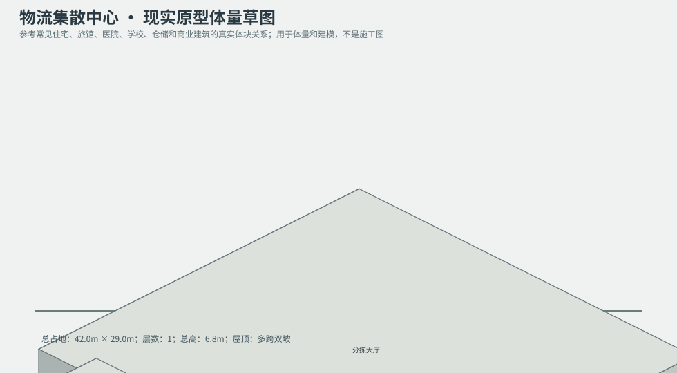
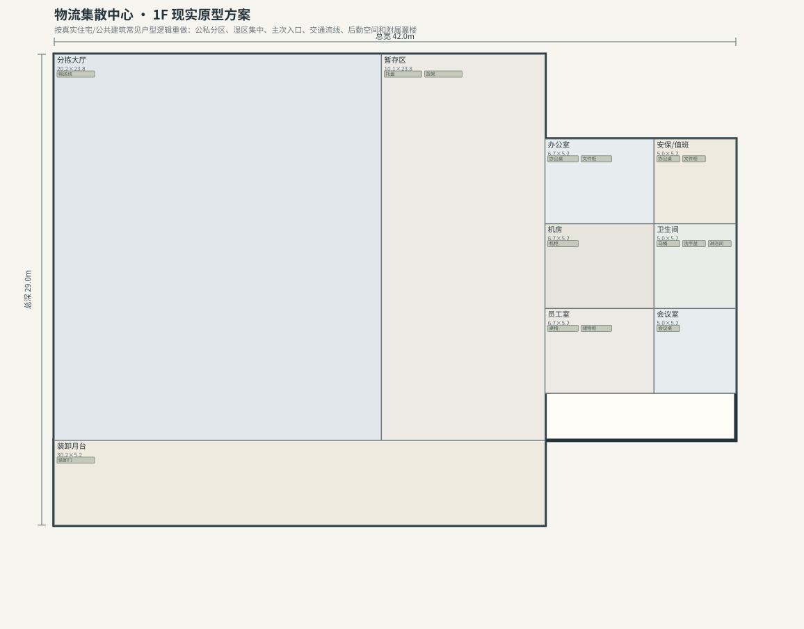

# BLD_039 · 物流集散中心 — 现实原型重制说明

## 重制目标
本建筑按真实世界常见建筑原型重做，强调：体量变化、主次入口、公私分区、湿区集中、楼梯/电梯核、后勤空间、车库或设备翼、以及更合理的家具和动线。

## 基本参数
- 使用性质：工业
- 占地：42.0m × 29.0m
- 层数：1
- 总高：6.8m
- 屋顶：多跨双坡
- 外立面：金属围护/预制混凝土

## 分层布局

### 1F

| 空间 | 尺寸（米） | 家具/设施 | 现实依据与功能 |
|---|---|---|---|
| 分拣大厅 | 20.2 × 23.8 | 输送线 | 交通空间 |
| 暂存区 | 10.1 × 23.8 | 托盘、货架 | 按真实房型功能组织 |
| 办公室 | 6.7 × 5.2 | 办公桌、文件柜 | 按真实房型功能组织 |
| 安保/值班 | 5.0 × 5.2 | 办公桌、文件柜 | 按真实房型功能组织 |
| 机房 | 6.7 × 5.2 | 机柜 | 按真实房型功能组织 |
| 卫生间 | 5.0 × 5.2 | 马桶、洗手盆、淋浴间 | 湿区集中 |
| 员工室 | 6.7 × 5.2 | 桌椅、储物柜 | 按真实房型功能组织 |
| 会议室 | 5.0 × 5.2 | 会议桌 | 按真实房型功能组织 |
| 装卸月台 | 30.2 × 5.2 | 装卸门 | 按真实房型功能组织 |

## 游戏实现建议
- 用门、窗、楼梯、电梯核和家具碰撞去驱动导航，而不是只看外轮廓。
- 体量图中的不同翼楼、附属房和门廊建议建成独立美术模块，便于LOD和损坏替换。
- 房间容器建议按用途绑定掉落池，如厨房、药房、后仓、设备间、宿舍、档案室等。
- 真实导向不等于过度复杂；仍需为AI寻路、玩家识别和性能服务。
