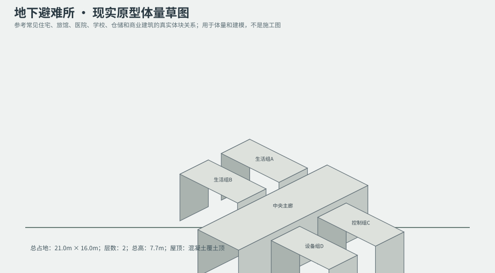
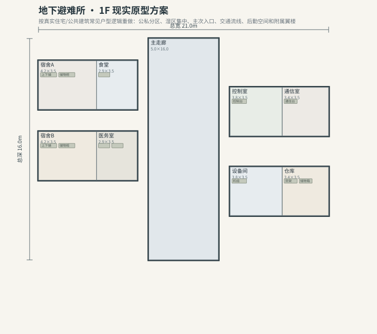
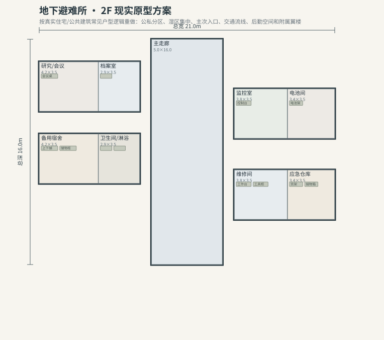

# BLD_040 · 地下避难所 — 现实原型重制说明

## 重制目标
本建筑按真实世界常见建筑原型重做，强调：体量变化、主次入口、公私分区、湿区集中、楼梯/电梯核、后勤空间、车库或设备翼、以及更合理的家具和动线。

## 基本参数
- 使用性质：特殊
- 占地：21.0m × 16.0m
- 层数：2
- 总高：7.7m
- 屋顶：混凝土覆土顶
- 外立面：混凝土/钢门

## 分层布局

### 1F

| 空间 | 尺寸（米） | 家具/设施 | 现实依据与功能 |
|---|---|---|---|
| 主走廊 | 5.0 × 16.0 | 无 | 交通空间 |
| 宿舍A | 4.2 × 3.5 | 上下铺、储物柜 | 按真实房型功能组织 |
| 食堂 | 2.9 × 3.5 | 餐桌 | 按真实房型功能组织 |
| 宿舍B | 4.2 × 3.5 | 上下铺、储物柜 | 按真实房型功能组织 |
| 医务室 | 2.9 × 3.5 | 检查床、柜体 | 按真实房型功能组织 |
| 控制室 | 3.8 × 3.5 | 控制台 | 按真实房型功能组织 |
| 通信室 | 3.4 × 3.5 | 通信台 | 按真实房型功能组织 |
| 设备间 | 3.8 × 3.5 | 机组 | 按真实房型功能组织 |
| 仓库 | 3.4 × 3.5 | 货架、储物箱 | 按真实房型功能组织 |

### 2F

| 空间 | 尺寸（米） | 家具/设施 | 现实依据与功能 |
|---|---|---|---|
| 主走廊 | 5.0 × 16.0 | 无 | 交通空间 |
| 研究/会议 | 4.2 × 3.5 | 会议桌 | 按真实房型功能组织 |
| 档案室 | 2.9 × 3.5 | 档案柜 | 按真实房型功能组织 |
| 备用宿舍 | 4.2 × 3.5 | 上下铺、储物柜 | 按真实房型功能组织 |
| 卫生间/淋浴 | 2.9 × 3.5 | 马桶、洗手盆、淋浴间 | 湿区集中 |
| 监控室 | 3.8 × 3.5 | 控制台 | 按真实房型功能组织 |
| 电池间 | 3.4 × 3.5 | 电池架 | 按真实房型功能组织 |
| 维修间 | 3.8 × 3.5 | 工作台、工具柜 | 按真实房型功能组织 |
| 应急仓库 | 3.4 × 3.5 | 货架、储物箱 | 按真实房型功能组织 |

## 游戏实现建议
- 用门、窗、楼梯、电梯核和家具碰撞去驱动导航，而不是只看外轮廓。
- 体量图中的不同翼楼、附属房和门廊建议建成独立美术模块，便于LOD和损坏替换。
- 房间容器建议按用途绑定掉落池，如厨房、药房、后仓、设备间、宿舍、档案室等。
- 真实导向不等于过度复杂；仍需为AI寻路、玩家识别和性能服务。
